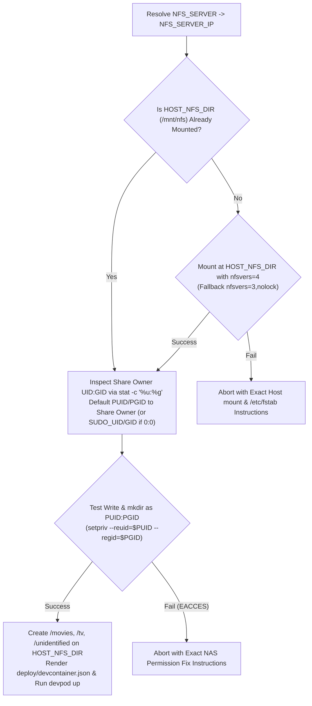

# DevPod Daemon Configuration, Host NFS Bind Mount & Atomic Transfer (`DOCKER.md`)

This document specifies the standalone DevPod daemon container configuration (`deploy/devcontainer.json` + `Dockerfile`), host NFS mount instructions and bind-mount setup (`HOST_NFS_DIR` -> `/mnt/nfs`), `install.sh` host pre-flight verification (including `nfsvers` auto-negotiation and `root_squash` / `PUID:PGID` detection), and the Go daemon's atomic NFS transfer implementation (resolving [Issue #5](https://github.com/brotherlogic/hometheatre/issues/5)).

---

## 1. Standalone DevPod Daemon (`deploy/devcontainer.json`) & `.env` Specification

### 1.1 Separating Development (`.devcontainer/`) from the Appliance Daemon (`deploy/`)
- **Development Container (`.devcontainer/devcontainer.json`):** Used strictly for interactive development (`hometheatre` workspace managed by `devcontainer-manager`).
- **Standalone Appliance Daemon (`deploy/devcontainer.json`):** Runs the Home Theatre ripper and Web UI as a completely separate DevPod container instance (`--id hometheatre-daemon`, `--devcontainer-path deploy/devcontainer.json`).
- **Why `deploy/devcontainer.json` + `/usr/local/bin/start-daemon.sh`:**
  - DevPod (`devpod up`) overrides the container image's default `ENTRYPOINT` with its own keepalive process and executes `postStartCommand` on container start.
  - `Dockerfile` installs `/usr/local/bin/start-daemon.sh`, which `deploy/devcontainer.json` invokes via `postStartCommand`. The script is idempotent (`pgrep -x hometheatre`), exports container-internal paths (`SCRATCH_DIR=/scratch`, `NFS_ROOT=/mnt/nfs`), and spawns a detached `nohup` supervisor loop that automatically restarts `/usr/local/bin/hometheatre` if it ever exits.
  - Both local scratch storage (`SCRATCH_DIR`) and the host-mounted NAS media folder (`HOST_NFS_DIR`, default `/mnt/nfs`) are passed into the DevPod container via `type=bind` mounts alongside `--security-opt label=disable`.

```json
{
	"name": "Home Theatre Daemon",
	"build": {
		"dockerfile": "../Dockerfile",
		"context": ".."
	},
	"workspaceFolder": "/workspaces/hometheatre",
	"remoteUser": "root",
	"capAdd": [
		"SYS_RAWIO"
	],
	"runArgs": [
		"--security-opt",
		"label=disable",
		"--network=host",
		"--device=/dev/sr0:/dev/sr0",
		"--device=/dev/sg0:/dev/sg0",
		"--group-add=24",
		"--env-file",
		"${localWorkspaceFolder}/.env"
	],
	"mounts": [
		"source=/var/lib/hometheatre/scratch,target=/scratch,type=bind",
		"source=/mnt/nfs,target=/mnt/nfs,type=bind"
	],
	"containerEnv": {
		"OPTICAL_DEVICE": "/dev/sr0",
		"CONTAINER_OPTICAL_DEVICE": "/dev/sr0",
		"CONTAINER_SCRATCH_DIR": "/scratch",
		"CONTAINER_NFS_ROOT": "/mnt/nfs",
		"DVDCSS_METHOD": "key",
		"DVDCSS_CACHE": "/scratch/.dvdcss",
		"DVDCSS_VERBOSE": "1"
	},
	"postStartCommand": "/usr/local/bin/start-daemon.sh"
}
```

### 1.2 `.env` Configuration Schema
`install.sh` generates and validates `.env` with the following variables (and renders the concrete host paths into `deploy/devcontainer.json`):

```dotenv
# Optical Drive Passthrough (auto-detected by install.sh)
OPTICAL_SR_DEVICE=/dev/sr0
OPTICAL_SG_DEVICE=/dev/sg1
CDROM_GID=24

# Host NFS Mount & NAS Configuration
HOST_NFS_DIR=/mnt/nfs
NFS_SERVER=nas.local
NFS_SERVER_IP=192.168.1.50
NFS_PATH=/volume1/media
NFS_OPTS=rw,nfsvers=4,hard,timeo=600,retrans=2,rsize=1048576,wsize=1048576,noatime

# NFS File Ownership (auto-detected from NFS share by install.sh)
PUID=1000
PGID=1000

# Local Scratch Storage (>= 25 GiB free space required)
SCRATCH_DIR=/var/lib/hometheatre/scratch

# Metadata, Web UI & DevPod Workspace
TMDB_API_KEY=your_tmdb_api_key_here
WEB_PORT=8080
WEBHOOK_URL=
DAEMON_WORKSPACE_ID=hometheatre-daemon
```

---

## 2. Host NFS Mount Instructions & Mount Options (`HOST_NFS_DIR` & `NFS_OPTS`)

### 2.1 Mounting the NAS Media Folder on the Host at `/mnt/nfs`
Because DevPod uses standard DevContainer bind mounts (`type=bind`) rather than Docker Compose named volume plugins, the NAS media export is mounted on the **host** at a known path (`HOST_NFS_DIR`, default `/mnt/nfs`) and bind-mounted into the `hometheatre-daemon` container at `/mnt/nfs`.

1. **Create the Host Mount Directory:**
   ```bash
   sudo mkdir -p /mnt/nfs
   ```
2. **Mount Immediately on the Host (or let `sudo ./install.sh` mount it):**
   ```bash
   sudo mount -t nfs \
     -o rw,nfsvers=4,hard,timeo=600,retrans=2,rsize=1048576,wsize=1048576,noatime \
     <NFS_SERVER_IP>:<NFS_PATH> /mnt/nfs
   ```
3. **Persist Across Host Reboots (`/etc/fstab`):**
   Add the following line to `/etc/fstab` on your host:
   ```fstab
   <NFS_SERVER_IP>:<NFS_PATH> /mnt/nfs nfs rw,nfsvers=4,hard,timeo=600,retrans=2,rsize=1048576,wsize=1048576,noatime,_netdev 0 0
   ```

### 2.2 Why `hard` (and Never `soft`) for Multi-Gigabyte `.iso` Transfers
Transferring a `4.7 GB` (`DVD-5`) or `8.5 GB` (`DVD-9`) `.iso` from local scratch to the NAS streams thousands of sequential RPC write requests over the network:
- **Never use `soft` for writes:** As documented in `man 5 nfs`, a `soft` mount causes the kernel NFS client to abort an RPC request and return an error to userspace if a transient NAS hiccup (such as a RAID parity flush, disk spin-up from standby, or brief network congestion) exceeds `timeo * retrans`, which can cause silent write corruption or premature transfer aborts.
- **Why `hard,timeo=600,retrans=2` is safe on modern Linux:**
  - `hard` ensures the kernel retries interrupted write RPCs transparently if the NAS experiences a momentary stall during disk spin-up.
  - Note that the legacy `intr` mount option was deprecated and became a no-op after Linux kernel `2.6.25`; modern Linux kernels automatically place `hard` NFS RPC waits in `TASK_KILLABLE` state, meaning processes blocked on an unresponsive NFS server can still be terminated via `SIGKILL` (`kill -9`).
- **Throughput & Metadata Optimization (`rsize=1048576,wsize=1048576,noatime`):**
  - Setting `1 MiB` (`1,048,576` bytes) read/write block sizes maximizes sequential throughput for multi-gigabyte `.iso` writes (the kernel automatically negotiates down to the NAS server's maximum supported payload if smaller).
  - `noatime` suppresses redundant metadata RPC round-trips when reading `.probe.json` sidecars or verifying written files.

### 2.3 Auto-Negotiating `nfsvers=4` vs. `nfsvers=3,nolock` in `install.sh`
If `HOST_NFS_DIR` is not already mounted when `install.sh` runs, `install.sh` automatically mounts the NAS share onto `HOST_NFS_DIR`:
1. **Primary Probe (`nfsvers=4`):**
   ```text
   rw,nfsvers=4,hard,timeo=600,retrans=2,rsize=1048576,wsize=1048576,noatime
   ```
   Preferred on modern NAS appliances (Synology, TrueNAS, Unraid, QNAP, Linux `nfs-kernel-server`) because NFSv4 uses a single TCP port (`2049`) and integrated stateful locking without requiring `rpcbind` (`portmapper`) or `rpc.statd`.
2. **Fallback Probe (`nfsvers=3,nolock`):**
   ```text
   rw,nfsvers=3,nolock,hard,timeo=600,retrans=2,rsize=1048576,wsize=1048576,noatime
   ```
   Used automatically if the NAS share is exported exclusively for NFSv3 (common on older NAS setups configured specifically for Kodi's built-in `libnfs` client). `nolock` is included for NFSv3 so file locks remain local to the single writer container without requiring `rpc.statd`/`lockd` firewall ports on the host or NAS.

### 2.4 NAS Export Requirement for Standalone Kodi Clients on Google TV & Tablets (`insecure` / Non-Root Ports)
While the Linux host mounts the NAS export using the in-kernel NFS client (which binds privileged source ports `< 1024`), standalone **Kodi apps on Google TV and Android tablets** use Kodi's built-in userspace `libnfs` library, which runs as an unprivileged Android app and connects from unprivileged source ports (`> 1024`).
- On Linux `nfs-kernel-server`, TrueNAS, and Unraid, the NAS NFS export **must include the `insecure` option** (allowing NFS requests from ports `> 1024`), and on Synology/QNAP, default non-privileged port access must remain enabled.
- Without `insecure` on the NAS export, the Linux host and DevPod container will write to the NFS share cleanly, **but Kodi on Google TV/tablets will receive `Permission Denied` when browsing `nfs://<NFS_SERVER>/<NFS_PATH>`**.
- `install.sh` explicitly highlights this requirement in its final Kodi onboarding summary.

---

## 3. Host Pre-Flight Checks & DevPod Deployment in `install.sh`

### 3.1 Prerequisite Verification (`devpod` + Host NFS Tools)
`install.sh` verifies that `devpod` (or `devpod-cli`) is installed and available on the host, and on Debian/Ubuntu hosts ensures `nfs-common`, `dnsutils`, `util-linux`, `lsscsi`, `udev`, and `curl` are installed.

### 3.2 Resolving `NFS_SERVER` to `NFS_SERVER_IP`
- `install.sh` accepts either a hostname (`nas.local`) or an IP address (`192.168.1.50`) for `NFS_SERVER`.
- It resolves the IPv4 address via `getent ahostsv4 "$NFS_SERVER" | awk 'NR==1 {print $1}'` and saves:
  - `NFS_SERVER`: Preserved for human-readable output and Kodi source instructions (`nfs://<NFS_SERVER><NFS_PATH>/movies`).
  - `NFS_SERVER_IP`: Used for the host mount and printed in the `/etc/fstab` instructions.

### 3.3 Host Mount Verification, `root_squash` Detection, & Directory Initialization
During `install.sh`, before launching the DevPod daemon container:



1. **Auto-Detecting `PUID` and `PGID`:**
   - Once mounted at `$HOST_NFS_DIR`, `install.sh` inspects the share's ownership:
     ```bash
     SHARE_UID=$(stat -c '%u' "$HOST_NFS_DIR")
     SHARE_GID=$(stat -c '%g' "$HOST_NFS_DIR")
     ```
   - If `PUID`/`PGID` are not already set in `.env`:
     - If `$SHARE_UID != 0` and `$SHARE_UID != 65534` (`nobody`), `install.sh` defaults `PUID=$SHARE_UID` and `PGID=$SHARE_GID` (matching the NAS media owner automatically).
     - Otherwise, it defaults to `${SUDO_UID:-1000}` and `${SUDO_GID:-1000}`.
2. **Verifying Write Access & `root_squash` Compatibility:**
   - Because most NAS exports enable `root_squash` by default (mapping UID `0` to `65534` / `nobody` and rejecting writes from `root` with `EACCES`), `install.sh` tests creating the directory structure and writing a `.hometheatre_write_test` file using the target `PUID:PGID` credentials via `setpriv`:
     ```bash
     setpriv --reuid="$PUID" --regid="$PGID" --clear-groups \
       bash -c "mkdir -p '$HOST_NFS_DIR/movies' '$HOST_NFS_DIR/tv' '$HOST_NFS_DIR/unidentified' && \
                touch '$HOST_NFS_DIR/.hometheatre_write_test' && \
                rm -f '$HOST_NFS_DIR/.hometheatre_write_test'"
     ```
   - If this succeeds, `install.sh` confirms that both the NFS export ACL and filesystem permissions for `PUID:PGID` are valid—even when `root_squash` is active on the NAS.

### 3.4 Rendering `deploy/devcontainer.json` & Launching the DevPod Daemon Workspace
To make `install.sh` 100% idempotent across configuration changes:
1. `install.sh` writes the validated `.env` file and renders `deploy/devcontainer.json` with the exact host device paths (`OPTICAL_SR_DEVICE`, `OPTICAL_SG_DEVICE`, `CDROM_GID`) and host bind mounts (`source=${SCRATCH_DIR},target=/scratch,type=bind` and `source=${HOST_NFS_DIR},target=/mnt/nfs,type=bind`).
2. `install.sh` invokes DevPod to build and recreate the standalone daemon workspace (`hometheatre-daemon`):
   ```bash
   devpod up . --id hometheatre-daemon --devcontainer-path deploy/devcontainer.json --ide none --recreate
   ```
3. If `install.sh` was run via `sudo` by a non-root user who has `~/.devpod` configured, `install.sh` runs `devpod` as `$SUDO_USER` so the workspace is registered in the user's DevPod context alongside their other DevPod workspaces.

---

## 4. Go Daemon NFS Writer (`Setfsuid`/`Setfsgid`, Atomic Staging, & Error Recovery)

### 4.1 Thread-Scoped `Setfsuid` / `Setfsgid` for `root_squash` Compatibility
Per [`DRIVE.md`](DRIVE.md), the Go daemon runs as `root` (`UID 0`) so optical drive ioctls (`CDROM_DRIVE_STATUS`, `DVD_AUTH`, `SG_IO`) and `CAP_SYS_RAWIO` work without permission friction.

However, when writing to an NFS share with `root_squash` enabled, calling `os.MkdirAll` or `os.OpenFile(..., O_CREATE)` as `UID 0` will be mapped by the NFS server to `nobody` (`65534`) and rejected with `EACCES` before `os.Chown` can ever run.

To support `root_squash` NAS exports seamlessly while keeping the daemon process as `root`:
- On Linux, `setfsuid(2)` and `setfsgid(2)` are **per-OS-thread** kernel attributes that determine the UID/GID sent in VFS and NFS RPC headers (`AUTH_SYS`) without altering the process's effective UID or capabilities on other threads.
- Whenever the Go NFS worker performs file or directory operations on `/mnt/nfs`, it pins the current goroutine to its OS thread via `runtime.LockOSThread()`, switches filesystem credentials to `PUID:PGID`, and restores `0:0` upon completion:

```go
package nfs

import (
	"runtime"

	"golang.org/x/sys/unix"
)

// WithNFSUser executes fn on a locked OS thread with its Linux filesystem
// credentials (fsuid/fsgid) set to puid:pgid so NFS RPCs authenticate as the
// configured NAS user even when root_squash is enabled on the NFS export.
func WithNFSUser(puid, pgid int, fn func() error) error {
	if puid <= 0 && pgid <= 0 {
		return fn()
	}

	runtime.LockOSThread()
	defer runtime.UnlockOSThread()

	unix.Setfsgid(pgid)
	unix.Setfsuid(puid)
	defer func() {
		unix.Setfsuid(0)
		unix.Setfsgid(0)
	}()

	return fn()
}
```

### 4.2 Cross-Filesystem Transfer & Atomic `.iso` Placement
Because local scratch (`/scratch`) and the bind-mounted NAS share (`/mnt/nfs`) are separate filesystems, `os.Rename` across them returns `EXDEV` (`invalid cross-device link`). Copying a `4.7–8.5 GB` `.iso` over 1 Gbps Ethernet takes ~45–90 seconds.

To guarantee that Kodi clients scanning the NFS share **never see a half-written `.iso` or an `.iso` without its companion `.nfo`**, the background worker executes the following strict sequence inside `WithNFSUser(puid, pgid, ...)`:

1. **Create Destination Directory:**
   `os.MkdirAll(destDir, 0o755)` (e.g., `/mnt/nfs/movies/The Matrix (1999)` or `/mnt/nfs/unidentified`).
2. **Check for Target Collision (Never Silently Overwrite during Auto-Filing):**
   - Before copying, the worker checks `os.Stat(finalISOPath)`.
   - If `finalISOPath` **already exists** on the NAS during automatic movie filing (for example, the user inserted Disc 2 of a 2-Disc Special Edition or re-inserted an already-ripped movie), the daemon **does not overwrite** the existing `.iso`. Instead, it routes the rip to `/mnt/nfs/unidentified/<RAW_LABEL>_<TIMESTAMP>.iso` with `"reason": "target_already_exists"` in `.probe.json` so the user can choose in the Web UI whether to replace, keep as a separate edition, or discard.
3. **Write and `fsync` Companion `.nfo` / `.probe.json` First:**
   - For identified movies/shows, write `tvshow.nfo` (if missing) and `<Title>.nfo` (written via `.nfo.partial` -> `Sync()` -> `Close()` -> `os.Rename` to `.nfo`) **before** the `.iso` appears.
   - For unidentified discs, write `<RAW_LABEL>_<TIMESTAMP>.probe.json` first.
4. **Stream `.iso` to Hidden Staging File in Target Directory:**
   - Copy `/scratch/job_<id>/disc.iso` to `/mnt/nfs/.../.<TargetName>.iso.partial` using a `1 MiB` (`1,048,576`-byte) `io.CopyBuffer`.
   - Using a leading dot and `.partial` extension (`/.Movie Title (Year).iso.partial`) ensures Kodi ignores the in-flight file during library scans, and placing it in the final target directory ensures the subsequent rename stays within the same directory on the NFS export.
5. **Explicit `Sync()` (`fsync`) and Checked `Close()`:**
   - Call `dstFile.Sync()` followed by `if err := dstFile.Close(); err != nil` before renaming.
   - On Linux NFS clients (which use close-to-open cache consistency and asynchronous writeback pages), errors from dirty page flushes can be reported on `fsync()` or `close()`. Checking both ensures every byte is committed to the NAS storage before the file becomes visible.
6. **Atomic In-Directory `os.Rename`:**
   - Call `os.Rename(partialISOPath, finalISOPath)`.
   - Because both paths reside in the same directory on `/mnt/nfs`, this issues a single atomic `NFS RENAME` RPC on the NAS.
7. **Delete Local Scratch Only After Full Success:**
   - Only after `Sync()`, `Close()`, and `os.Rename()` all return `nil` does the daemon remove `/scratch/job_<id>/disc.iso` (and `/scratch/job_<id>`).

### 4.3 Zero-Copy Web UI Tagging (`/unidentified` -> `/movies` or `/tv`)
Because `/mnt/nfs/unidentified`, `/mnt/nfs/movies`, and `/mnt/nfs/tv` all reside within the same `/mnt/nfs` bind mount:
- When a user confirms a Movie or TV Series tag in the Web UI for an `.iso` sitting in `/mnt/nfs/unidentified/`, the Go daemon:
  1. Creates the destination directory in `/mnt/nfs/movies/...` or `/mnt/nfs/tv/...`.
  2. Writes and `fsync`s `tvshow.nfo` (if applicable) and the companion `.nfo` file.
  3. Calls `os.Rename("/mnt/nfs/unidentified/<RAW>.iso", "/mnt/nfs/movies/.../<Title>.iso")`.
  4. Removes `/mnt/nfs/unidentified/<RAW>.probe.json`.
- Because both paths are on the same NFS mount, `os.Rename` executes as an **instant, zero-copy server-side rename on the NAS** in milliseconds without transferring the multi-gigabyte `.iso` over the network a second time.

### 4.4 Transient NFS Failure & Retry Policy
If any step of the `/scratch` -> `/mnt/nfs` transfer fails (e.g., `ENOSPC` on the NAS or a network error):
1. The daemon removes any incomplete `.<TargetName>.iso.partial` file on the NFS share if reachable.
2. **Preserves `/scratch/job_<id>/disc.iso` and its probed metadata on local scratch disk.**
3. Marks the job as `NFS Transfer Pending (Retry)` in the Web UI, sends a notification to `WEBHOOK_URL` (if configured), and retries the transfer with exponential backoff (`15s`, `30s`, `1m`, `2m`, capped at `5m` intervals) — plus a manual **"Retry Transfer Now"** button in the Web UI — until the NAS is reachable again.
