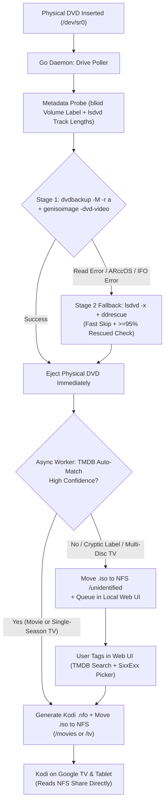

# Home Theatre: Automated DVD ISO Ripper & Kodi NFS Pipeline (`INTENT.md`)

## 1. Project Vision & Goal
Build a zero-touch, appliance-like DVD backup pipeline running in Docker on a Linux host (`Debian`/`Ubuntu`):
1. **Drop a DVD into the physical drive** and walk away.
2. The container automatically detects the disc, decrypts it, rips a **full 1:1 DVD `.iso` backup** (preserving original DVD menus, special features, audio tracks, and subtitles) to local scratch storage, and **immediately auto-ejects the physical disc** so the next DVD can be inserted right away.
3. In the background, the service builds/finalizes the `.iso`, identifies the Movie or TV Series (using DVD volume label, `lsdvd` track durations, and the **TMDB API**), generates a companion **Kodi `.nfo` metadata file**, and moves the result to an **existing NAS NFS share**.
4. **Kodi** clients running independently on **Google TV** and a **tablet** read directly from the NAS NFS share over the network—playing full DVD ISOs with original menus and 100% accurate library metadata without needing a middleman media server.

---

## 2. System Architecture & Data Flow



---

## 3. Architectural Decisions

### 3.1 Host & Container Platform
- **Host OS:** Debian / Ubuntu Linux with a physical optical drive attached (`/dev/sr0` + `/dev/sg*`).
- **Runtime:** Docker & Docker Compose (`restart: unless-stopped`).
- **Drive Detection:** In-container polling loop monitoring `/dev/sr0` state changes (avoids fragile host-level `udev` triggers calling `docker exec` and keeps live drive status visible in the Web UI).

### 3.2 Storage & Staging Strategy
- **Local Scratch Disk (`SCRATCH_DIR`):** Requires ~20 GB of free local disk space on the container host.
  - Ripping and building the `.iso` on local disk first avoids network bottlenecks/stalls during optical reads, ensures Stage 2 (`ddrescue`) fallback can still access the physical disc if `genisoimage -dvd-video` rejects protected `.IFO` tables, and allows the physical DVD tray to **eject immediately** once the local `.iso` is finalized—while TMDB matching and the multi-gigabyte NFS file transfer continue asynchronously in the background.
- **NAS NFS Mount:** Mounted directly by Docker Compose using the local `nfs` volume driver (configured via `.env` variables `NFS_SERVER`, `NFS_PATH`, `NFS_OPTS`).

### 3.3 DVD Ripping Engine (100% Open-Source, Two-Stage Pipeline)
- **Output Format:** Decrypted, region-free 1:1 `.iso` image (preserves DVD menus and extras; supported natively by Kodi's `VideoPlayer` over NFS).
- **Decryption:** `libdvdcss2` + `libdvdread` compiled cleanly in an intermediate Docker build stage via `libdvd-pkg` (no proprietary software or expiring MakeMKV beta keys).
- **Two-Stage Rip Strategy — See [`RIPPING.md`](RIPPING.md):**
  1. **Primary (`dvdbackup` + `genisoimage`):** Runs `dvdbackup -M -r a -n dvd` to mirror the decrypted `VIDEO_TS` structure to local scratch, builds the compliant DVD `.iso` via `genisoimage -quiet -dvd-video`, removes the temporary `VIDEO_TS` folder, and immediately ejects the disc.
  2. **Fallback (`ddrescue`):** Commercial DVDs with structural copy protection (Sony ARccOS, Disney X-Protect, Lionsgate RipGuard) or minor physical scratches may fail `dvdbackup` or `genisoimage -dvd-video`. When detected, the pipeline re-unlocks the drive's CSS bus (`lsdvd -x`), runs single-pass `ddrescue` (`-b 2048 -n -N -K 64Ki,1Mi -O -T 2m`), verifies `>= 95%` rescued sectors in the mapfile, and ejects the disc.

### 3.4 Identification, Kodi Naming, & `.nfo` Sidecars
- **Media Types Supported:** Both **Movies** and **TV Series** box sets.
- **Heuristics + TMDB Lookup:**
  - Extracts raw volume label (`blkid`) and title count/durations (`lsdvd`).
  - Uses track duration heuristics (e.g., one 80–210 min feature track = Movie; multiple 20–60 min tracks = TV Series disc with $N$ episodes) combined with the **TMDB API**.
- **Kodi NFS Directory Layout & Naming Conventions:**
  - **Movies:**
    ```text
    <NFS_ROOT>/movies/Movie Title (Year)/
      ├── Movie Title (Year).iso
      └── Movie Title (Year).nfo
    ```
  - **TV Series (Multi-Episode ISO):**
    Kodi requires multi-episode DVD ISOs to list the episodes in the filename so its TV scraper indexes every episode on the disc:
    ```text
    <NFS_ROOT>/tv/Show Title (Year)/Season 01/
      ├── Show Title - S01E01E02E03E04.iso
      └── Show Title - S01E01E02E03E04.nfo
    ```
  - **Unidentified / Ambiguous Discs:**
    ```text
    <NFS_ROOT>/unidentified/<RAW_LABEL>_<TIMESTAMP>.iso
    ```
- **Companion `.nfo` Files:**
  - Every identified `.iso` gets a companion Kodi `.nfo` XML file containing the exact TMDB URL/ID and metadata. This ensures independent Kodi instances on Google TV and tablets always match 100% accurately without mis-scraping.

### 3.5 Lightweight Go Service & Web UI
- **Language:** **Go (Golang)** compiled via a multi-stage Dockerfile into a single static binary.
- **Responsibilities of the Go Daemon:**
  1. Poll `/dev/sr0` for disc insertion and drive readiness.
  2. Orchestrate the two-stage ripping CLI tools (`blkid`, `lsdvd`, `dvdbackup`, `genisoimage`, `ddrescue`, `eject`).
  3. Manage concurrent worker queues (Drive Reader queue vs. Background ISO Build + NFS Transfer queue).
  4. Query TMDB REST API and generate Kodi `.nfo` XML files.
  5. Serve a lightweight embedded **Web UI** (`net/http` + `html/template`) showing:
     - Live optical drive & background queue status
     - Recent rip history & logs
     - **"Unidentified / Needs Tagging" queue**: lets the user search TMDB, select Movie vs. TV Show (with Season + starting/ending episode numbers auto-suggested from `lsdvd` track count), and move/rename the `.iso` + generate the `.nfo` on the NFS share with one click.
  6. Send an optional webhook notification (`WEBHOOK_URL` in `.env`) on rip completion, error, or when manual tagging is needed.

### 3.6 Playback Clients (Kodi)
- **Independent Clients:** Standalone Kodi apps on Google TV and tablet (no central MariaDB server required).
- **Network Protocol:** Kodi reads directly from the NAS NFS share (`nfs://<NFS_SERVER>/<NFS_PATH>/movies` and `/tv`).

---

## 4. Host Installer & Repository Deliverables

### 4.1 Installer Script (`install.sh`)
An idempotent Bash installer script targeting Debian/Ubuntu hosts that:
1. Checks and installs host prerequisites (`docker.io` / `docker-ce`, `docker-compose-plugin`, `nfs-common`, `lsscsi`, `udev`).
2. Detects attached optical drives (`/dev/sr*` and corresponding generic SCSI `/dev/sg*` devices) and verifies device permissions.
3. Prompts for (or reads from `.env`) configuration values:
   - `NFS_SERVER` and `NFS_PATH` (and tests mounting/reachability from the host)
   - `TMDB_API_KEY` (validates against TMDB API)
   - `SCRATCH_DIR` (verifies at least ~20 GB free local disk space)
   - `WEB_PORT` (default e.g. `8080`)
   - `WEBHOOK_URL` (optional)
4. Initializes the required folder structure on the NFS share (`movies/`, `tv/`, `unidentified/`).
5. Builds and starts the Docker Compose stack (`docker compose up -d --build`).
6. Outputs a summary with the local Web UI URL and exact NFS paths to enter into Kodi on Google TV and the tablet.

---

## 5. Research & Verification Backlog
Before building out the full Go daemon and installer scripts, we should research and validate the following technical details:

1. **Optical Drive Detection & Polling in Docker (Linux `/dev/sr0` + `/dev/sg*`) — See [`DRIVE.md`](DRIVE.md):**
   - Best non-intrusive way in Go/Linux to poll `/dev/sr0` for disc presence (`ioctl` `CDROM_DRIVE_STATUS` vs `blkid` / `/sys/class/block/sr0/events`) without repeatedly spinning up an empty drive or blocking when the tray is open.
   - Required Docker device mappings (`/dev/sr0` + `/dev/sg*`), group permissions (`cdrom`), and capabilities (`SYS_RAWIO` if needed for CSS key exchange).
2. **`libdvdcss2` Installation in Debian/Ubuntu Docker Images — See [`RIPPING.md`](RIPPING.md):**
   - Clean, non-interactive installation of `libdvdcss2` inside a multi-stage Dockerfile (compiling `libdvdcss2_*.deb` via Debian `contrib` `libdvd-pkg` in an intermediate builder stage and installing only the `.deb` in `debian:bookworm-slim`).
3. **Two-Stage Rip Commands & Flags (`dvdbackup`, `genisoimage`, `ddrescue`) — See [`RIPPING.md`](RIPPING.md):**
   - Exact CLI flags for Stage 1 (`dvdbackup -M -r a -n dvd` + `genisoimage -quiet -dvd-video -V <LABEL_32>`) prior to ejecting so `.IFO` layout errors can still fall back to Stage 2.
   - Stage 2 `ddrescue` flags (`-b 2048 -n -N -K 64Ki,1Mi -O -T 2m`) after re-unlocking CSS bus keys via `lsdvd -x /dev/sr0`, plus `>= 95%` rescued mapfile validation.
4. **DVD Volume Label & `lsdvd` Parsing Heuristics:**
   - Parsing `lsdvd -Ox` (XML) or `lsdvd -Oj` (JSON) output in Go to reliably extract track lengths, distinguish Movies from multi-episode TV discs, and clean up raw DVD volume labels (stripping `_16X9`, `_WS`, `DISC_1`, etc.) before querying TMDB.
5. **Kodi `.nfo` Specification for Movie & Multi-Episode TV ISOs:**
   - Verify exact Kodi `.nfo` XML schema for standalone movies and multi-episode TV `.iso` files (`<episodedetails>` blocks + TMDB unique IDs) so Kodi scrapes posters, episode titles, and descriptions automatically.
6. **Docker Compose NFS Volume Driver Behavior:**
   - Confirm best NFS mount options (`nfsvers=4` vs `nfsvers=3`, `nolock`, `soft`/`hard`) in `docker-compose.yml` on Debian/Ubuntu hosts and how `install.sh` should pre-flight test NFS write access.

---

## 6. Implementation Roadmap
1. **Phase 1 — Research & Technical Spike:** Investigate and document findings for the 6 research items above (CLI flags, `ioctl`/polling, Kodi `.nfo` format, Docker NFS volume config).
2. **Phase 2 — Installer & Infrastructure (`install.sh` + `Dockerfile` + `docker-compose.yml`):** Build the idempotent Debian/Ubuntu host installer script, `.env.example`, and container image with `libdvdcss2`, `dvdbackup`, `genisoimage`, `gddrescue`, and `lsdvd`.
3. **Phase 3 — Go Ripping & Identification Daemon:** Implement the drive poller, two-stage ripper (`dvdbackup` -> eject -> `genisoimage` / `ddrescue` fallback), `lsdvd` + TMDB matcher, and Kodi `.nfo` writer.
4. **Phase 4 — Embedded Web UI & Kodi Onboarding Guide:** Add the local web dashboard for live status and one-click tagging of unidentified/TV discs, plus a quick-start guide for pointing Kodi on Google TV and tablets at the NFS share.
