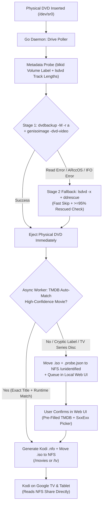

# Home Theatre: Automated DVD ISO Ripper & Kodi NFS Pipeline (`INTENT.md`)

## 1. Project Vision & Goal
Build a zero-touch, appliance-like DVD backup pipeline running in a standalone DevPod container on a Linux host:
1. **Drop a DVD into the physical drive** and walk away.
2. The container automatically detects the disc, decrypts it, rips and finalizes a **full 1:1 DVD `.iso` backup** (preserving original DVD menus, special features, audio tracks, and subtitles) on local scratch storage, and **immediately auto-ejects the physical disc** so the next DVD can be inserted right away.
3. In the background, the service identifies the Movie or TV Series (using DVD volume label, `lsdvd` track durations, and the **TMDB API**), generates a companion **Kodi `.nfo` metadata file**, and moves the `.iso` and `.nfo` to an **existing NAS NFS share**.
4. **Kodi** clients running independently on **Google TV** and a **tablet** read directly from the NAS NFS share over the network—playing full DVD ISOs with original menus and 100% accurate library metadata without needing a middleman media server.

---

## 2. System Architecture & Data Flow



---

## 3. Architectural Decisions

### 3.1 Host & Container Platform
- **Host OS:** Linux host with a physical optical drive attached (`/dev/sr0` + `/dev/sg*`).
- **Runtime:** Standalone **DevPod** daemon workspace (`hometheatre-daemon`, configured via [`deploy/devcontainer.json`](deploy/devcontainer.json) and supervised by `/usr/local/bin/start-daemon.sh`), kept completely distinct from the `.devcontainer/` development workspace.
- **Drive Detection:** In-container polling loop monitoring `/dev/sr0` state changes (avoids fragile host-level `udev` triggers and keeps live drive status visible in the Web UI).

### 3.2 Storage & Staging Strategy — See [`DOCKER.md`](DOCKER.md) & [`RIPPING.md`](RIPPING.md)
- **Local Scratch Disk (`SCRATCH_DIR`):** Requires **`>= 25 GiB`** of free local disk space on the container host (`30+ GiB` recommended for back-to-back dual-layer ripping), enforced by both `install.sh` and a runtime `unix.Statfs` space gate (`>= 18 GiB` free before starting a new rip).
  - Ripping and building the `.iso` on local disk first avoids network bottlenecks/stalls during optical reads, ensures Stage 2 (`ddrescue`) fallback can still access the physical disc if `genisoimage -dvd-video` rejects protected `.IFO` tables, persists job state in `<job_dir>/job.json` for crash recovery across container restarts, and allows the physical DVD tray to **eject immediately** once the local `.iso` is finalized—while TMDB matching and the multi-gigabyte NFS file transfer continue asynchronously in the background.
- **Host NFS Mount & Bind Mount (`HOST_NFS_DIR` -> `/mnt/nfs`):** Mounted on the host at a known path (`HOST_NFS_DIR`, default `/mnt/nfs`) and bind-mounted into the DevPod daemon container (`source=${HOST_NFS_DIR},target=/mnt/nfs,type=bind`), with `install.sh` verifying or mounting `nfsvers=4` (falling back to `nfsvers=3,nolock`), auto-detecting share `PUID`/`PGID` for `root_squash` compatibility (applied via thread-scoped `Setfsuid`/`Setfsgid` in Go), and staging transfers to hidden `.iso.partial` files with `fsync` + atomic `os.Rename`.

### 3.3 DVD Ripping Engine (100% Open-Source, Two-Stage Pipeline)
- **Output Format:** Decrypted, region-free 1:1 `.iso` image (preserves DVD menus and extras; supported natively by Kodi's `VideoPlayer` over NFS).
- **Decryption:** `libdvdcss2` + `libdvdread` compiled cleanly in an intermediate Dockerfile build stage via `libdvd-pkg` (no proprietary software or expiring MakeMKV beta keys).
- **Two-Stage Rip Strategy — See [`RIPPING.md`](RIPPING.md):**
  1. **Primary (`dvdbackup` + `genisoimage`):** Runs `dvdbackup -M -r a -n dvd` to mirror the decrypted `VIDEO_TS` structure to local scratch, builds the compliant DVD `.iso` via `genisoimage -quiet -dvd-video`, removes the temporary `VIDEO_TS` folder, and immediately ejects the disc.
  2. **Fallback (`ddrescue`):** Commercial DVDs with structural copy protection (Sony ARccOS, Disney X-Protect, Lionsgate RipGuard) or minor physical scratches may fail `dvdbackup` or `genisoimage -dvd-video`. When detected, the pipeline re-unlocks the drive's CSS bus (`lsdvd -x`), runs single-pass `ddrescue` (`-b 2048 -n -N -K 64Ki,1Mi -O -T 2m`), verifies `>= 95%` rescued sectors in the mapfile, and ejects the disc.

### 3.4 Identification, Kodi Naming, & `.nfo` Sidecars — See [`METADATA.md`](METADATA.md)
- **Media Types Supported:** Both **Movies** and **TV Series** box sets.
- **Heuristics + TMDB Lookup:**
  - Extracts raw volume label (`blkid` primary, `lsdvd -Ox` fallback) and title durations (`lsdvd -Ox` XML, re-probing the finalized local `.iso` if the initial `/dev/sr0` probe failed).
  - Filters out composite `"Play All"` tracks and deduplicates identical-duration logical PGCs (`Δ < 0.1s`) to classify **Movie** (`60–240m` feature track) vs. **TV Series** ($N \ge 2$ clustered `18–65m` episode tracks).
  - Supports both TMDB v3 API Keys (`?api_key=`) and v4 Read Access Tokens (`Authorization: Bearer`). Auto-files high-confidence **Movies** (non-generic label + exact normalized TMDB title match + DVD feature duration within `±15m` of TMDB runtime); routes **TV Series** discs, multi-disc collisions, offline lookups, and ambiguous/cryptic discs to `/unidentified` with a `.probe.json` sidecar containing pre-populated TMDB candidates and suggested episode counts for 1-click Web UI confirmation.
- **Kodi NFS Directory Layout & Naming Conventions:**
  - **Movies:**
    ```text
    <NFS_ROOT>/movies/Movie Title (Year)/
      ├── Movie Title (Year).iso
      └── Movie Title (Year).nfo
    ```
  - **TV Series (Multi-Episode ISO):**
    Kodi requires a series-level `tvshow.nfo` in the show root directory plus multi-episode DVD ISOs that list the episodes in the filename and companion `.nfo` so its TV scraper indexes every episode on the disc:
    ```text
    <NFS_ROOT>/tv/Show Title (Year)/
      ├── tvshow.nfo
      └── Season 01/
        ├── Show Title - S01E01E02E03E04.iso
        └── Show Title - S01E01E02E03E04.nfo
    ```
  - **Unidentified / Needs Confirmation Queue:**
    ```text
    <NFS_ROOT>/unidentified/
      ├── <RAW_LABEL>_<TIMESTAMP>.iso
      └── <RAW_LABEL>_<TIMESTAMP>.probe.json
    ```
- **Companion `.nfo` Files:**
  - Every identified `.iso` gets a companion Kodi `.nfo` XML file populated from TMDB (`<movie>` or concatenated `<episodedetails>` blocks, plus idempotent `<tvshow>` `tvshow.nfo`) with `<uniqueid type="tmdb" default="true">`. This ensures independent Kodi instances on Google TV and tablets always match 100% accurately without mis-scraping.

### 3.5 Lightweight Go Service & Web UI
- **Language:** **Go (Golang)** compiled via a multi-stage Dockerfile into a single static binary.
- **Responsibilities of the Go Daemon:**
  1. Poll `/dev/sr0` for disc insertion and drive readiness.
  2. Orchestrate the two-stage ripping CLI tools (`blkid`, `lsdvd`, `dvdbackup`, `genisoimage`, `ddrescue`, `eject`) with runtime scratch space gating and `job.json` crash recovery.
  3. Manage concurrent worker queues (Drive Reader & Local ISO Finalizer queue vs. Background TMDB + NFS Transfer queue).
  4. Query TMDB REST API and generate Kodi `.nfo` XML files.
  5. Serve a lightweight embedded **Web UI** (`net/http` + `html/template`) showing:
     - Live optical drive & background queue status
     - Recent rip history & logs (persisted in `<SCRATCH_DIR>/history.json`)
     - **"Unidentified / Needs Tagging" queue**: lets the user search TMDB, select Movie (with optional Disc/Edition suffix for multi-disc sets) vs. TV Show (with Season + starting/ending episode numbers auto-suggested from `lsdvd` track count), and move/rename the `.iso` + generate the `.nfo` on the NFS share with one click.
  6. Send an optional webhook notification (`WEBHOOK_URL` in `.env`) on rip completion, error, or when manual tagging is needed.

### 3.6 Playback Clients (Kodi)
- **Independent Clients:** Standalone Kodi apps on Google TV and tablet (no central MariaDB server required).
- **Network Protocol:** Kodi reads directly from the NAS NFS share (`nfs://<NFS_SERVER>/<NFS_PATH>/movies` and `/tv`; NAS export must allow unprivileged ports via `insecure` for Kodi's userspace `libnfs` client on Android/Google TV).

---

## 4. Host Installer & Repository Deliverables

### 4.1 Installer Script (`install.sh`)
An idempotent Bash installer script targeting Linux hosts with DevPod that:
1. Checks host prerequisites (`devpod` / `devpod-cli`, `nfs-common`, `dnsutils`, `util-linux`, `lsscsi`, `udev`, `curl`).
2. Loads and persists the `sg` kernel module (`modprobe sg` + `/etc/modules-load.d/hometheatre-sg.conf`), detects attached optical drives (`/dev/sr*` and corresponding generic SCSI `/dev/sg*` devices via `sysfs`), and verifies device permissions.
3. Prompts for (or reads from `.env`) configuration values:
   - `HOST_NFS_DIR` (default `/mnt/nfs`, bind-mounted into the DevPod daemon container at `/mnt/nfs`)
   - `NFS_SERVER` and `NFS_PATH` (resolves `NFS_SERVER_IP`, verifies or mounts `HOST_NFS_DIR` using `nfsvers=4` vs `nfsvers=3,nolock`, auto-detects `PUID`/`PGID`, and tests write access via `setpriv`)
   - `TMDB_API_KEY` (validates v3 API key or v4 Bearer token against TMDB API)
   - `SCRATCH_DIR` (verifies at least **`25 GiB`** free local disk space)
   - `WEB_PORT` (default e.g. `8080`)
   - `WEBHOOK_URL` (optional)
   - `DAEMON_WORKSPACE_ID` (default `hometheatre-daemon`, distinct from the `hometheatre` development container)
4. Initializes the required folder structure on the NFS share (`movies/`, `tv/`, `unidentified/`).
5. Renders `deploy/devcontainer.json` with the configured host bind mounts and device passthrough, then builds and starts the standalone DevPod daemon workspace (`devpod up . --id hometheatre-daemon --devcontainer-path deploy/devcontainer.json --ide none --recreate`).
6. Outputs a summary with the local Web UI URL, `/etc/fstab` host mount line, and exact NFS paths (plus `insecure` export reminder) to enter into Kodi on Google TV and the tablet.

---

## 5. Research & Verification Backlog (Completed)
All technical specifications for Phase 1 have been verified and documented:

1. **Optical Drive Detection & Polling in DevPod (Linux `/dev/sr0` + `/dev/sg*`) — See [`DRIVE.md`](DRIVE.md):**
   - Non-intrusive polling via `ioctl(CDROM_DRIVE_STATUS)` with `O_RDONLY | O_NONBLOCK`, single-trigger insertion latch, DevPod `runArgs` device mappings (`/dev/sr0` + `/dev/sg*`), `cdrom` GID, `CAP_SYS_RAWIO`, and `sysfs` drive discovery with `sg` module persistence.
2. **`libdvdcss2` Installation in Debian Container Images — See [`RIPPING.md`](RIPPING.md):**
   - Clean, non-interactive compilation of `libdvdcss2_*.deb` via Debian `contrib` `libdvd-pkg` in an intermediate builder stage (`dvdcss-builder`) and installation of only the `.deb` in `debian:bookworm-slim`.
3. **Two-Stage Rip Commands, Scratch Space Gate & Crash Recovery (`dvdbackup`, `genisoimage`, `ddrescue`) — See [`RIPPING.md`](RIPPING.md):**
   - Stage 1 (`dvdbackup -M -r a -n dvd` + `genisoimage -quiet -dvd-video -V <LABEL_32>`) prior to ejecting so `.IFO` layout errors can still fall back to Stage 2; Stage 2 `ddrescue` (`-b 2048 -n -N -K 64Ki,1Mi -O -T 2m`) after re-unlocking CSS bus keys via `lsdvd -x /dev/sr0`, `>= 95%` rescued mapfile validation, `>= 18 GiB` runtime `Statfs` gate, and `<job_dir>/job.json` crash recovery.
4. **DVD Volume Label & `lsdvd` Parsing Heuristics — See [`METADATA.md`](METADATA.md):**
   - Parsing `lsdvd -Ox` (XML in `lsdvd 0.17`, with bare `&` / UTF-8 sanitization in Go), filtering composite `"Play All"` tracks and duplicate logical PGCs (`Δ < 0.1s`), classifying Movies vs. TV Series discs, dual v3/v4 TMDB auth, offline fallback, and persisting `.probe.json` sidecars in `/unidentified`.
5. **Kodi `.nfo` Specification, Multi-Disc Handling & Webhooks — See [`METADATA.md`](METADATA.md):**
   - Full Kodi `.nfo` XML schemas populated from TMDB for standalone movies (`<movie>`), multi-disc movie suffix resolution (`Disc 2` / `Bonus Features`), TV series root directories (`tvshow.nfo` `<tvshow>`), multi-episode TV `.iso` files (concatenated root-level `<episodedetails>` blocks), `<SCRATCH_DIR>/history.json` persistence, and `WEBHOOK_URL` JSON payload format.
6. **DevPod Daemon & Host NFS Bind Mount Behavior — See [`DOCKER.md`](DOCKER.md):**
   - Host NFS mount at `HOST_NFS_DIR` (`/mnt/nfs`) with auto-negotiated `nfsvers=4` (fallback `nfsvers=3,nolock`) and `rw,hard,timeo=600,retrans=2,rsize=1048576,wsize=1048576,noatime`, DevPod bind mounting (`deploy/devcontainer.json`), `install.sh` pre-flight write/ownership testing (`PUID`/`PGID` + `Setfsuid`/`Setfsgid` for `root_squash`), Kodi `libnfs` `insecure` port requirement, and atomic `.iso.partial` + `fsync` + `os.Rename` transfer staging.

---

## 6. Implementation Roadmap
1. **Phase 1 — Research & Technical Spike (Completed):** Documented in [`DRIVE.md`](DRIVE.md), [`RIPPING.md`](RIPPING.md), [`METADATA.md`](METADATA.md), and [`DOCKER.md`](DOCKER.md).
2. **Phase 2 — Installer & Infrastructure (`install.sh` + `Dockerfile` + `deploy/devcontainer.json`):** Build the idempotent Linux host installer script, `.env.example`, and DevPod daemon container image with `libdvdcss2`, `dvdbackup`, `genisoimage`, `gddrescue`, and `lsdvd`.
3. **Phase 3 — Go Ripping & Identification Daemon:** Implement the drive poller, two-stage ripper (`dvdbackup` + `genisoimage` -> `eject`, or `ddrescue` fallback -> `eject`), `job.json` crash recovery, `lsdvd` + TMDB matcher, and atomic NFS + Kodi `.nfo` writer.
4. **Phase 4 — Embedded Web UI & Kodi Onboarding Guide:** Add the local web dashboard for live status, `history.json`, webhook notifications, and one-click tagging of unidentified/TV/multi-disc ISOs, plus a quick-start guide for pointing Kodi on Google TV and tablets at the NFS share.
