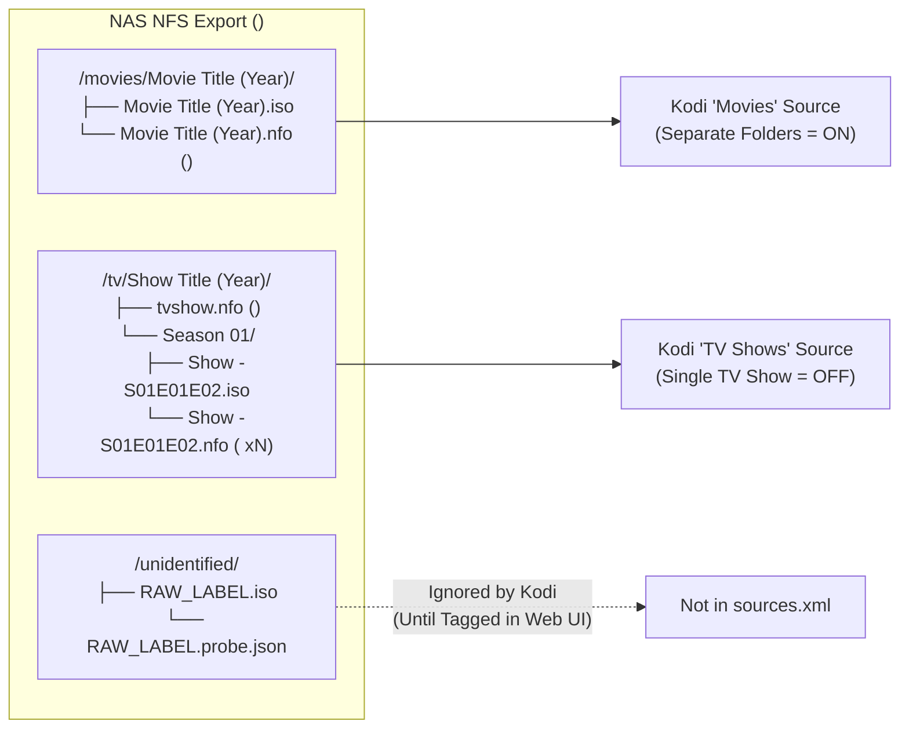

# Kodi NFS Setup Guide & Helper Configuration for Google TV and Tablet (`KODI.md`)

This guide documents how to configure standalone **Kodi** clients on **Google TV** and **Android tablets** to stream decrypted 1:1 DVD `.iso` images and index companion `.nfo` metadata directly from the NAS NFS share (resolving [Issue #11](https://github.com/brotherlogic/hometheatre/issues/11)).

---

## 1. Architecture Overview (Independent Clients, Zero Middleman Server)

Per [`INTENT.md` Section 3.6](INTENT.md), each Kodi device on your local network connects directly to the NAS NFS export over standard network shares:
- **Movies NFS Source:** `nfs://<NFS_SERVER>/<NFS_PATH>/movies/`
- **TV Shows NFS Source:** `nfs://<NFS_SERVER>/<NFS_PATH>/tv/`
- **Unidentified Staging Queue (Excluded from Kodi):** `<NFS_PATH>/unidentified/` is intentionally excluded from Kodi's video sources so discs awaiting 1-click confirmation in the Web UI never pollute your library.

Because the Home Theatre daemon writes complete Kodi-compliant `.nfo` XML sidecars (`<movie>`, `tvshow.nfo`, and multi-episode `<episodedetails>`) with explicit `<uniqueid type="tmdb" default="true">` tags and high-resolution TMDB artwork URLs **before** atomically renaming each `.iso` into place ([`DOCKER.md` Section 4.2](DOCKER.md)), every standalone Kodi client on Google TV and tablets achieves 100% identical, accurate library metadata without requiring a central MariaDB database or transcoding server.

---

## 2. NAS NFS Export Requirements for Kodi (`libnfs` & `insecure` Ports)

### 2.1 Why Kodi on Google TV & Tablets Requires `insecure` (Ports `> 1024`)
As detailed in [`DOCKER.md` Section 2.4](DOCKER.md):
- The **Linux host** mounts your NAS share using the in-kernel NFS client (`mount.nfs`), which runs as `root` and binds privileged TCP source ports (`< 1024`).
- Standalone **Kodi apps on Google TV and Android tablets** run as unprivileged Android applications and use Kodi's built-in userspace **`libnfs`** library, which connects from unprivileged ephemeral source ports (`> 1024`).

> [!IMPORTANT]
> By default, many NAS NFS servers enforce the `secure` export option, rejecting any NFS request originating from a port `> 1024`. Without enabling **`insecure`** (non-root port access) on your NAS export, the DevPod ripper container will write files to the NAS without issue, **but Kodi on Google TV and tablets will fail with `Permission Denied` (`NFS3ERR_ACCES`) or an empty directory when opening `nfs://<NFS_SERVER>/<NFS_PATH>`**.

### 2.2 NAS Platform Configuration Reference

Configure your NAS NFS export for `<NFS_PATH>` to allow unprivileged source ports (`> 1024`) and read access (or read/write access) for your local LAN subnet:

| NAS Platform | Where to Configure | Required Setting for Kodi `libnfs` |
| :--- | :--- | :--- |
| **Linux (`nfs-kernel-server`)** | `/etc/exports` | Add `insecure` to the export options and reload:<br>`/srv/nfs/media 192.168.1.0/24(rw,sync,no_subtree_check,insecure)`<br>Then run: `sudo exportfs -ra` |
| **TrueNAS SCALE / CORE** | *Shares -> UNIX (NFS) Shares -> Edit -> Advanced Options* | Check **Allow non-root mount** (sets `insecure` on the export). Ensure your LAN subnet or Kodi client IPs are authorized under *Networks* / *Hosts*. |
| **Synology DSM** | *Control Panel -> Shared Folder -> (Select Share) -> Edit -> NFS Permissions* | Create/edit the rule for your LAN CIDR (e.g., `192.168.1.0/24`):<br>• **Privilege:** *Read/Write* (or *Read only* for a separate Kodi rule)<br>• **Allow connections from non-privileged ports (ports higher than 1024):** Enabled by default on DSM (keep enabled)<br>• **Allow users to access mounted subfolders:** *Checked* |
| **Unraid** | *Shares -> (Select Share) -> NFS Security Settings* | Set **Security** to *Private* (or *Public*) with rule:<br>`*(sec=sys,rw,insecure,anongid=100,anonuid=99,no_root_squash)` |
| **QNAP QTS / QuTS hero** | *Control Panel -> Privilege -> Shared Folders -> Edit Shared Folder Permission -> NFS host access* | Grant *Read/Write* or *Read only* to your LAN subnet (`192.168.1.0/24`). QNAP allows unprivileged ports (`insecure`) by default. |

### 2.3 NFSv3 Support & Static IP Recommendation for Android / Google TV
1. **Keep NFSv3 Enabled Alongside NFSv4 on the NAS:**
   While the Linux host mount auto-negotiates `nfsvers=4` first ([`DOCKER.md` Section 2.3](DOCKER.md)), Kodi's built-in `libnfs` client defaults to **NFSv3** (`rpcbind`/portmapper on TCP/UDP port `111`, `mountd`, and `nfsd` on port `2049`). Keep both NFSv3 and NFSv4 enabled on your NAS (the standard default on Synology, TrueNAS, Unraid, QNAP, and `nfs-kernel-server`).
   *(Note: If your NAS is configured strictly as NFSv4-only with `rpcbind` disabled, Kodi 20+ supports appending `?version=4` to the source path, e.g., `nfs://192.168.1.50/volume1/media/movies/?version=4`).*
2. **Prefer Static IPv4 over `.local` mDNS Hostnames in Kodi:**
   Android's Bionic DNS resolver inside userspace `libnfs` does not reliably resolve multicast DNS (`.local` Avahi/Bonjour) hostnames on all Google TV and tablet firmware builds. Using your NAS's static IPv4 address (e.g., `192.168.1.50`) or a standard router DNS hostname in `nfs://` URLs prevents intermittent lookup failures.

---

## 3. Adding the NAS NFS Sources in Kodi

You can configure the `Movies` and `TV Shows` NFS sources on Google TV and tablets either by deploying the provided [`sources.xml`](sources.xml) template or manually through the Kodi interface.

### 3.1 Method A: Using the Helper Configuration Template ([`sources.xml`](sources.xml))

The repository includes a ready-to-use [`sources.xml`](sources.xml) template defining:
- **`Movies`** -> `nfs://${NFS_SERVER}${NFS_PATH}/movies/`
- **`TV Shows`** -> `nfs://${NFS_SERVER}${NFS_PATH}/tv/`
- **`HomeTheatre NAS`** (File Manager root) -> `nfs://${NFS_SERVER}${NFS_PATH}/`

#### Step 1: Render `sources.xml` with Your NAS IP and Export Path
Replace `192.168.1.50` and `/volume1/media` with your NAS's IP address and exported media path:

```bash
NFS_SERVER="192.168.1.50"
NFS_PATH="/volume1/media"
sed -e "s|\${NFS_SERVER}|${NFS_SERVER}|g" \
    -e "s|\${NFS_PATH}|${NFS_PATH%/}|g" \
    sources.xml > sources.kodi.xml
```

Verify the rendered paths inside `sources.kodi.xml`:
```xml
        <source>
            <name>Movies</name>
            <path pathversion="1">nfs://192.168.1.50/volume1/media/movies/</path>
            <allowsharing>true</allowsharing>
        </source>
        <source>
            <name>TV Shows</name>
            <path pathversion="1">nfs://192.168.1.50/volume1/media/tv/</path>
            <allowsharing>true</allowsharing>
        </source>
```

#### Step 2: Push `sources.kodi.xml` to Google TV or Android Tablet via ADB
1. Launch Kodi at least once on the Google TV or tablet so it initializes its `.kodi/userdata` directory structure, then close Kodi (*Power icon -> Exit*).
2. Enable **Developer options** and **USB debugging** / **Wireless debugging** on the Google TV or tablet, then run from your Linux host:
   ```bash
   adb connect <DEVICE_IP>:5555
   adb push sources.kodi.xml /sdcard/Android/data/org.xbmc.kodi/files/.kodi/userdata/sources.xml
   ```
3. Re-open Kodi and navigate to **Settings (Gear Icon) -> Media -> Library -> Videos**. You will see **Movies** and **TV Shows** pre-populated. Proceed to [Section 4](#4-configuring-kodi-library-scrapers-for-companion-nfo-files) to assign their content types and scrapers.

### 3.2 Method B: Adding NFS Sources via the Kodi UI (Remote or Touchscreen)

If you prefer not to use ADB, enter the NFS URLs directly in Kodi (entering the path explicitly is more reliable on Android/Google TV than browsing `Network File System (NFS)` zero-conf discovery across subnets):

1. Open Kodi and click the **Settings (Gear) icon** -> **Media** -> **Library** -> under *Manage Sources*, select **Videos...**.
2. Select **Add videos...** -> click **Browse** -> scroll down and select **Add network location...**.
3. Configure the network location dialog:
   - **Protocol:** `Network File System (NFS)`
   - **Server address:** `<NFS_SERVER_IP>` (e.g., `192.168.1.50`)
   - **Remote path:** `<NFS_PATH>/movies` (e.g., `volume1/media/movies` or `/volume1/media/movies` — Kodi normalizes the leading slash automatically)
   - Click **OK**.
4. Back in the *Add video source* dialog:
   - Select the newly added `nfs://192.168.1.50/volume1/media/movies/` entry.
   - Set the media source name to **`Movies`** and click **OK**.
5. Repeat steps 2–4 for the TV library:
   - **Protocol:** `Network File System (NFS)`
   - **Server address:** `<NFS_SERVER_IP>` (e.g., `192.168.1.50`)
   - **Remote path:** `<NFS_PATH>/tv` (e.g., `/volume1/media/tv`)
   - Set the media source name to **`TV Shows`** and click **OK**.

---

## 4. Configuring Kodi Library Scrapers for Companion `.nfo` Files

Per [`METADATA.md` Section 5](METADATA.md), the Go daemon generates comprehensive Kodi `.nfo` XML sidecar files for every Movie and TV Series disc. Configuring Kodi's content settings on each source tells Kodi how to traverse the folder hierarchy and ingest those `.nfo` files.



### 4.1 Configuring the `Movies` Source (`nfs://<NFS_SERVER>/<NFS_PATH>/movies/`)

In **Settings -> Media -> Library -> Videos**, highlight **Movies**, open the **Context Menu** (long-press **Select/OK** on a Google TV remote, press the **Menu** button, or **long-press** on a tablet touchscreen), and select **Change content** (or **Set content**):

| Setting | Recommended Value | Rationale |
| :--- | :--- | :--- |
| **This directory contains** | **Movies** | Enables the Movie library scanner and OSD features. |
| **Choose information provider** | **Local information only** *(or **The Movie Database Python**)* | Every `.iso` in `/movies` already has a complete companion `<Movie Title (Year)>.nfo` with `<movie>` metadata, cast, plot, MPAA rating, `<uniqueid type="tmdb" default="true">`, and TMDB poster/fanart URLs. **Local information only** guarantees 100% deterministic indexing with zero risk of scraper mis-matching. *(If you choose **The Movie Database Python**, Kodi still prioritizes the local `.nfo` file first).* |
| **Movies are in separate folders that match the movie title** | **Enabled (ON)** | Matches the daemon's directory layout: `<NFS_ROOT>/movies/Movie Title (Year)/Movie Title (Year).iso`. |
| **Scan recursively** | **Enabled (ON)** | Scans all movie subdirectories beneath `/movies/`. |
| **Exclude path from library updates** | **Disabled (OFF)** | Ensures new rips are picked up during library scans. |

Click **OK** and answer **Yes** when prompted to *"Refresh information for all items within this path?"*.

> [!NOTE]
> **Multi-Disc Movies & Bonus Discs (`METADATA.md` Section 5.4):**
> When a second disc is filed into the same movie folder via the Web UI with an Edition/Disc suffix (e.g., `Movie Title (Year) - Disc 2.iso` and `Movie Title (Year) - Disc 2.nfo` containing `<title>Movie Title (Disc 2)</title>`), Kodi indexes both the main feature and the bonus/second disc as distinct entries in your Movie library.

### 4.2 Configuring the `TV Shows` Source (`nfs://<NFS_SERVER>/<NFS_PATH>/tv/`)

Highlight **TV Shows**, open the **Context Menu**, and select **Change content** (or **Set content**):

| Setting | Recommended Value | Rationale |
| :--- | :--- | :--- |
| **This directory contains** | **TV shows** | Enables the TV Series / Season / Episode scanner. |
| **Choose information provider** | **Local information only** *(or **TMDB TV Shows**)* | Reads the daemon's series-level `tvshow.nfo` (`<tvshow>`) and multi-episode `Show Title - S01E01E02E03E04.nfo` (`<episodedetails>`) files directly. |
| **Selected folder contains a single TV show** | **Disabled (OFF)** | **Critical:** `/tv` is the parent directory containing multiple `<Show Title (Year)>/` folders. Leaving this **OFF** ensures Kodi treats each immediate child directory as a separate TV series. |
| **Exclude path from library updates** | **Disabled (OFF)** | Ensures newly tagged TV season discs are added on scan. |

Click **OK** and select **Yes** to scan the library.

#### How Kodi Indexes Multi-Episode TV DVD `.iso` Files
When a TV Series disc is confirmed in the Web UI (e.g., Season 1, Episodes 1–4), the daemon writes ([`METADATA.md` Section 5.3](METADATA.md)):
1. `<NFS_ROOT>/tv/Show Title (Year)/tvshow.nfo` — containing the `<tvshow>` XML block and `<uniqueid type="tmdb" default="true">`.
2. `<NFS_ROOT>/tv/Show Title (Year)/Season 01/Show Title - S01E01E02E03E04.iso` — the full 1:1 DVD `.iso` image.
3. `<NFS_ROOT>/tv/Show Title (Year)/Season 01/Show Title - S01E01E02E03E04.nfo` — containing four sequential root-level `<episodedetails>` XML blocks (`<episode>1</episode>` through `<episode>4</episode>`).

When Kodi scans the `TV Shows` source:
- It detects all episode tokens (`E01`, `E02`, `E03`, `E04`) in the `.iso` filename.
- It pairs each episode number with its corresponding `<episodedetails>` block in the `.nfo` file.
- All four episodes appear individually under **Season 1** in Kodi's TV Shows library with their own episode titles, plots, air dates, and thumbnails. Selecting any of those episodes launches the DVD `.iso`.

### 4.3 Automatic Library Updates on Independent Clients
Because Google TV and your tablet run independent Kodi instances without a central database server, enable automatic startup scans on both devices so newly ripped DVDs appear automatically whenever you open Kodi:
1. Go to **Settings (Gear Icon) -> Media -> Library** (set the bottom-left settings level gear to **Standard** or **Expert**).
2. Under **Video Library**, enable:
   - **Update library on startup:** `Enabled (ON)`
   - **Hide progress of library updates:** `Enabled (ON)` *(optional; keeps the top-right banner unobtrusive while watching videos)*

---

## 5. Recommended Kodi Playback Settings for 1:1 DVD `.iso` Images & Menus

Every `.iso` produced by the Home Theatre pipeline is an unencrypted, region-free 1:1 DVD backup preserving the original `VIDEO_TS` interactive menus, chapter stops, audio tracks (Dolby Digital AC3 / DTS / director commentaries), and VOBSUB subtitles.

Before configuring player settings, open **Settings (Gear Icon) -> Player** and click the gear icon in the **bottom-left corner** until the settings mode reads **Expert**.

### 5.1 Preserve Original Interactive DVD Menus (`Settings -> Player -> Discs`)
By default, Kodi plays DVD `.iso` images using its internal `libdvdnav` navigator. Verify the following under **Settings -> Player -> Discs**:

| Setting | Recommended Value | Rationale |
| :--- | :--- | :--- |
| **Play main movie automatically** *(Attempt to skip introduction before DVD menu)* | **Disabled (OFF)** | **Critical for 1:1 DVD `.iso` backups:** When OFF, launching a Movie or Multi-Episode TV `.iso` boots directly into the original interactive DVD menu so you can pick a specific episode, select commentary tracks, or browse bonus features. Turning this ON would skip the DVD menu and jump straight into the single longest track (breaking episode selection on TV Series discs). |
| **Force region code for DVD playback** | **Off (Default)** | `libdvdcss2` already strips CSS encryption and RPC region locks during the rip ([`RIPPING.md` Section 2](RIPPING.md)), so no region override is needed in Kodi. |

### 5.2 Video Cadence, Aspect Ratio & Deinterlacing (`Settings -> Player -> Videos`)
Commercial DVDs are mastered in standard-definition MPEG-2 (`720x480` NTSC or `720x576` PAL), often using interlaced video (`480i` / `576i`) for TV series and bonus documentaries or telecined `23.976 fps` for films:

1. **Display Refresh Rate Matching (Google TV):**
   - Go to **Settings -> Player -> Videos**:
     - **Adjust display refresh rate:** `On start / stop`
     - **Sync playback to display:** `Disabled (OFF)` *(keep OFF if using HDMI audio passthrough so AC3/DTS bitstream passthrough remains active)*
2. **Hardware Acceleration (`MediaCodec` on Android / Google TV):**
   - Under **Settings -> Player -> Videos -> Processing**:
     - **Allow hardware acceleration - MediaCodec (Surface):** `Enabled (ON)`
     - **Allow hardware acceleration - MediaCodec:** `Enabled (ON)`
   - *Troubleshooting tip:* On a small subset of Android TV / tablet SoCs, hardware `MediaCodec (Surface)` can occasionally hides or misalign the translucent highlight overlay on `4:3` DVD menus. If you ever notice invisible menu selection highlights on a specific device, disable **Allow hardware acceleration - MediaCodec (Surface)** (leaving standard **MediaCodec** ON or letting Kodi software-decode MPEG-2, which uses negligible CPU on modern ARM chips).
3. **Deinterlacing (`480i` / `576i` DVDs):**
   - While playing a DVD `.iso`, open the on-screen **Settings (Gear) icon -> Video settings**:
     - **Deinterlace video:** `Auto` (or `On`)
     - **View mode:** `Normal` (preserves original `16:9` widescreen and `4:3` aspect ratios without stretching)
     - Click **Set as default for all media** -> **Yes**.

### 5.3 Audio Passthrough (Google TV AVR/Soundbar vs. Tablet Speakers)
Under **Settings -> System -> Audio**:
- **Google TV Connected to an AVR or Soundbar:**
  - **Allow passthrough:** `Enabled (ON)`
  - **Dolby Digital (AC3) capable receiver:** `Enabled (ON)`
  - **DTS capable receiver:** `Enabled (ON)` *(if your receiver/soundbar supports DTS)*
  - This passes the original 5.1 surround AC3/DTS bitstream from the DVD `.iso` untouched to your sound system.
- **Tablet Built-in Speakers or Headphones:**
  - **Allow passthrough:** `Disabled (OFF)`
  - **Number of channels:** `2.0`
  - During playback, in **OSD -> Settings -> Audio settings**, consider setting **Volume amplification** or center-channel downmix boost if a 5.1 DVD track has quiet dialogue on stereo tablet speakers.

---

## 6. Navigating Original DVD Menus on Google TV Remotes & Tablet Touchscreens

### 6.1 Google TV Remote Navigation
Google TV remotes have a compact button layout (D-Pad `Up`/`Down`/`Left`/`Right`, center `Select`/`OK`, `Back`, `Home`, and volume). Kodi maps these natively when a DVD `.iso` is playing:

| Action | Google TV Remote Input | Behavior |
| :--- | :--- | :--- |
| **Move Between DVD Menu Buttons** | **D-Pad (`Up` / `Down` / `Left` / `Right`)** | Moves the DVD menu highlight (`libdvdnav` directional navigation) whenever a DVD menu is on screen. |
| **Activate Highlighted DVD Menu Item** | **Center `Select` / `OK`** | Activates the selected DVD button (*Play Movie*, *Episode Selection*, *Scene Selection*, *Special Features*, *Audio/Subtitles*). |
| **Return to DVD Root Menu Mid-Playback** | **`Select`/`OK` -> OSD `Disc Menu` Icon** | While watching a feature or episode track, press **`Select`/`OK`** to reveal the bottom On-Screen Display (OSD) bar, navigate right to the **Disc Menu icon** (a circular disc/menu icon next to the Settings gear), and press **`Select`/`OK`** to jump immediately back to the DVD Root Menu. |
| **Skip Chapters (`Next` / `Previous`)** | **D-Pad `Up` / `Down`** *(during video playback)* | Jumps forward or backward by one DVD chapter (`Chapter +1` / `Chapter -1`). |
| **Seek Forward / Rewind (`10s` / `30s`)** | **D-Pad `Left` / `Right`** *(during video playback)* | Steps backward/forward through the current track using Kodi's skip steps. |
| **Switch Audio Track / Commentary or Subtitles** | **`Select`/`OK` -> OSD `Subtitles` or `Settings` Icon** | Switches between AC3/DTS audio streams, director's commentary tracks, and DVD VOBSUB subtitle streams on the fly (or via the DVD's own *Setup* menu). |
| **Stop Playback** | **`Back`** -> **OSD `Stop` Square Icon** | Stops the `.iso` and returns to the Kodi library screen. |

> [!TIP]
> **One-Button DVD Menu Shortcut on Google TV (`Keymap Editor`):**
> If you want a single remote button to jump back to the DVD Root Menu at any time during playback, install the official **Keymap Editor** add-on from the Kodi Add-on Repository (*Add-ons -> Install from repository -> Program add-ons -> Keymap Editor*) and map **Fullscreen Video -> Navigation -> Show Video Menu** (`PlayerControl(ShowVideoMenu)`) to a long-press or spare button on your remote.

### 6.2 Android Tablet Touchscreen Navigation

#### 1. Enable Kodi's Touch-Optimized Skin (`Estouchy`)
Kodi's default **Estuary** skin is designed for TV remotes, whereas **Estouchy** is built specifically for tablet touchscreens and ships pre-installed with Kodi:
1. Open **Settings (Gear Icon) -> Interface -> Skin**.
2. Select **Skin** and switch from *Estuary* to **Estouchy**.
3. Confirm **Yes** to keep the change.

#### 2. Interacting with Original DVD Menus on a Touchscreen
| Action | Tablet Touchscreen Input | Behavior |
| :--- | :--- | :--- |
| **Select & Activate a DVD Menu Button** | **Tap directly on the DVD menu item** | Kodi's `libdvdnav` touch handler translates screen tap coordinates directly into DVD menu button selection and activation (`SelectAndActivateButton`). |
| **Open the Playback OSD Bar** | **Single-tap anywhere on the video** during playback *(or tap the screen edge in menus)* | Reveals the touch OSD bar with Play/Pause, Chapter Skip, Subtitles, Audio/Video Settings, and the **DVD Menu** button. |
| **Return to the DVD Root Menu Mid-Playback** | **Tap video -> Tap the `Disc Menu` icon** on the OSD bar | Jumps from the active movie or TV episode track back to the interactive DVD Root Menu (e.g., to pick the next episode on a TV Series disc). |
| **Navigate Menus That Require Directional Keys** | **OSD Directional Overlay / Gesture** | A small number of older DVDs trigger menu transitions on cursor highlight movement rather than direct click activation. Keep **View mode** set to **Normal** in Video Settings so touch hitboxes align 1:1 with the DVD frame. |

---

## 7. Quick Troubleshooting Checklist

| Symptom in Kodi | Cause | Fix |
| :--- | :--- | :--- |
| Clicking `nfs://<NFS_SERVER>/<NFS_PATH>` shows nothing, fails to connect, or logs `NFS3ERR_ACCES` / `Permission Denied` | NAS NFS export requires privileged ports (`< 1024`), blocking Kodi's unprivileged Android `libnfs` client. | Add `insecure` (or enable **Allow non-root mount**) on the NAS NFS export for `<NFS_PATH>` (see [Section 2.2](#22-nas-platform-configuration-reference)). |
| `nfs://nas.local/...` fails to resolve on Google TV or tablet | Android's native resolver inside `libnfs` is not resolving multicast `.local` mDNS names. | Replace `nas.local` with the NAS static IPv4 address (`NFS_SERVER_IP` from `.env`, e.g., `nfs://192.168.1.50/...`) in [`sources.xml`](sources.xml). |
| Starting a DVD `.iso` skips the DVD menu and immediately plays a single track | *Play main movie automatically* is enabled under *Settings -> Player -> Discs*. | Disable **Play main movie automatically** in **Settings -> Player -> Discs** ([Section 5.1](#51-preserve-original-interactive-dvd-menus-settings---player---discs)). |
| DVD menu button highlights are invisible or shifted when navigating with the remote | Hardware surface rendering (`MediaCodec (Surface)`) overlay quirk on certain Android SoCs. | Go to **Settings -> Player -> Videos -> Processing** and disable **Allow hardware acceleration - MediaCodec (Surface)**. |
| TV Series episodes do not appear after ripping a TV DVD | TV Series discs always route to `/unidentified` first so you can confirm the Season and Episode range (`SxxExx`). | Open `http://<HOST_IP>:8080`, confirm the TV Show, Season, and Episode range in the **Unidentified Queue**, then run **Update library** in Kodi. |
