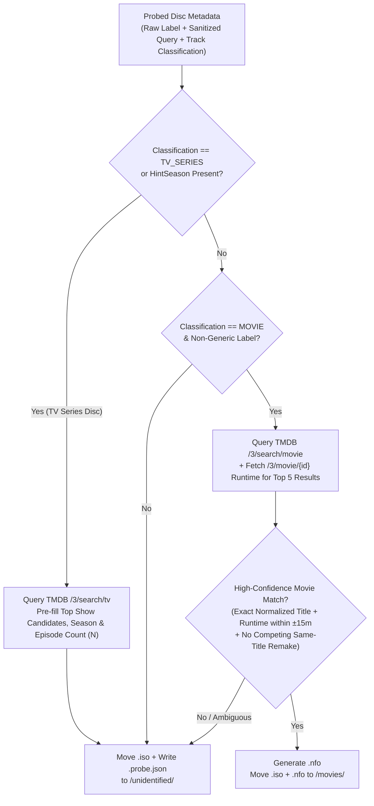

# DVD Metadata Probing, Track Heuristics, TMDB Matching & Kodi `.nfo` Specification (`METADATA.md`)

This document specifies how the Go daemon probes DVD volume labels and track durations (`blkid` + `lsdvd -Ox`), classifies Movies vs. TV Series discs, evaluates TMDB auto-match confidence, persists `.probe.json` sidecars for the `/unidentified` queue, and generates companion Kodi `.nfo` XML files (resolving [Issue #4](https://github.com/brotherlogic/hometheatre/issues/4)).

---

## 1. DVD Metadata Probing (`blkid` + `lsdvd -Ox`)

### 1.1 Two-Point Probe Timing
The daemon probes disc metadata on `/dev/sr0` immediately before starting Stage 1 (`dvdbackup`). Because commercial discs with mastering quirks or locked sectors can occasionally fail an initial `lsdvd` read on the physical drive before Stage 2 (`ddrescue`) completes, the daemon **automatically re-probes the finalized local `<job_dir>/disc.iso`** if the initial `/dev/sr0` probe failed or returned zero valid tracks.
- Both `blkid` and `lsdvd` (`libdvdread`) accept block devices (`/dev/sr0`) and regular `.iso` image files (`<job_dir>/disc.iso`) interchangeably.
- Re-probing the local `.iso` happens on local scratch disk after the physical DVD has already been ejected.

### 1.2 Volume Label Extraction (`blkid` Primary, `lsdvd` Fallback)
DVDs store volume identifiers in two places: the UDF Logical Volume Identifier (up to 128 characters) and the ISO9660 Primary Volume Descriptor at byte offset `32808` (32 characters, uppercase/underscores).
1. **Primary (`blkid`):**
   ```bash
   blkid -o value -s LABEL /dev/sr0
   ```
   `libblkid` inspects both UDF and ISO9660 superblocks and returns the cleanest volume label.
2. **Fallback (`lsdvd -Ox` `<title>`):**
   If `blkid` returns an empty string or `unknown`, the daemon falls back to the `<title>` element extracted by `lsdvd -Ox` from the ISO9660 header.
3. **Note on `<provider_id>`:**
   The 32-byte VMG `<provider_id>` in `VIDEO_TS.IFO` typically identifies the authoring house or studio (e.g., `WARNER_HOME_VIDEO`, `20TH_CENTURY_FOX`) rather than the film title and is never used as the title search query.

### 1.3 Parsing `lsdvd -Ox` XML in Go
`debian:bookworm-slim` packages `lsdvd 0.17`, which supports **`-Ox` (XML)** rather than `-Oj` (JSON was introduced later upstream in `lsdvd 0.18`).

Inspection of `lsdvd 0.17`'s `oxml.c` reveals two critical implementation details:
1. **Invoke `lsdvd -Ox <target>` without `-v` or `-x`:**
   When `-v` or `-x` is passed, `lsdvd 0.17` emits `<df>P&S + Letter</df>` or `<df>Pan&Scan</df>` using raw `vprintf` without escaping the `&` character, producing malformed XML. Running plain `lsdvd -Ox <target>` outputs only `<device>`, `<title>`, `<vmg_id>`, `<provider_id>`, `<track><ix>...</ix><length>...</length><vts_id>...</vts_id></track>`, and `<longest_track>`.
2. **Sanitize bare `&` and non-UTF8 bytes before `xml.Unmarshal`:**
   Because a disc's raw `<title>` or `<provider_id>` can still contain a literal `&` (e.g., `LAW_&_ORDER`) or stray Latin-1 bytes, the Go parser sanitizes the raw XML byte stream before calling `encoding/xml.Unmarshal`.

```go
package metadata

import (
	"bytes"
	"encoding/xml"
	"regexp"
	"unicode/utf8"
)

type LSDVDOutput struct {
	XMLName      xml.Name     `xml:"lsdvd"`
	Device       string       `xml:"device"`
	Title        string       `xml:"title"`
	VMGID        string       `xml:"vmg_id"`
	ProviderID   string       `xml:"provider_id"`
	Tracks       []LSDVDTrack `xml:"track"`
	LongestTrack int          `xml:"longest_track"`
}

type LSDVDTrack struct {
	Index  int     `xml:"ix"`
	Length float64 `xml:"length"` // Duration in seconds (%.3f)
	VTSID  string  `xml:"vts_id"`
}

var bareAmpersandRe = regexp.MustCompile(`&(?!(?:amp|lt|gt|apos|quot|#\d+|#x[0-9a-fA-F]+);)`)

func ParseLSDVDXML(raw []byte) (*LSDVDOutput, error) {
	clean := bytes.ToValidUTF8(raw, []byte(""))
	clean = bareAmpersandRe.ReplaceAll(clean, []byte("&amp;"))

	var out LSDVDOutput
	if err := xml.Unmarshal(clean, &out); err != nil {
		return nil, err
	}
	return &out, nil
}
```

---

## 2. Track-Length Heuristics (Movie vs. TV Series Classification)

> [!NOTE]
> The `.iso` rip itself is always a complete 1:1 disc backup. Track filtering and deduplication below apply **exclusively to the read-only metadata heuristic** used to classify the disc and pre-populate the Web UI episode picker.

Given the list of `<track>` durations (in seconds) from `lsdvd -Ox`, the classifier executes four steps:

### 2.1 Step 1 — Filter Menu Bumpers, Logos & Trailers
- Ignore all tracks shorter than **18 minutes (`< 1,080` seconds)**. This eliminates studio logos, FBI warnings, menu loops, and short promotional trailers.

### 2.2 Step 2 — Deduplicate Identical-Duration Logical PGCs (`Δ < 0.1s`)
- Many DVDs author multiple logical Program Chains (PGCs) that reference the exact same underlying video cells (for example, a 4-episode TV DVD exposing 8 tracks where tracks 1–4 and 5–8 have identical frame counts, or a movie disc with dual PGCs for alternate audio/subtitles).
- Because `lsdvd -Ox` reports track duration to millisecond precision (`%.3f`), two distinct episodes virtually never share the exact same duration within `0.1` seconds (`~2–3` video frames), whereas duplicate PGC pointers have identical durations.
- The heuristic collapses tracks whose durations differ by **`< 0.1` seconds** into a single logical duration for classification and episode-count estimation.

### 2.3 Step 3 — Detect and Exclude Composite "Play All" Tracks on TV Discs
- TV DVDs frequently include individual episode tracks (e.g., four `22m` tracks) alongside a single long **"Play All"** track (`~88m`) that chains every episode together.
- Before checking for a feature film, if there are $N \ge 2$ candidate episode tracks in the **`18–65` minute (`1,080s–3,900s`)** band, the heuristic computes their sum $S = \sum_{i=1}^{N} L_i$.
- Any long track $L_{\text{long}} \ge 60\text{ min}$ satisfying:
  $$|L_{\text{long}} - S| \le 300\text{ seconds (5 minutes)}$$
  is tagged as a composite `"Play All"` track and excluded from feature-film classification and episode counting.

### 2.4 Step 4 — Media Type Classification Rules
1. **`TV_SERIES`:**
   - After excluding any composite `"Play All"` track, there are **$N \ge 2$ deduplicated tracks** in the **`18–65` minute (`1,080s–3,900s`)** range whose durations cluster within **$\pm 15$ minutes (`900s`) of their median duration**.
   - Requiring cluster cohesion around the median prevents a Movie disc containing a `110m` feature plus a `45m` "Making Of" documentary and a `22m` deleted-scenes reel from being misclassified as a TV Series disc (Wait: if a Movie disc has a `110m` track AND two `25m` extras, see Rule 2 below!).
   - Furthermore, if the disc also contains a valid feature track **`> 75` minutes (`4,500s`)** that is *not* a `"Play All"` sum of the shorter tracks, and there are only `2` tracks in the `18–45m` range (typical bonus featurettes on a movie disc), **`MOVIE` takes precedence** unless the volume label explicitly contains a TV season/episode token (`S01`, `SEASON`, `EPISODE`).
   - **Estimated Episode Count:** $N$ (the number of clustered episode tracks).
2. **`MOVIE`:**
   - Not classified as `TV_SERIES`, and contains **$\ge 1$ track** in the **`60–240` minute (`3,600s–14,400s`)** range.
   - This cleanly handles:
     - Standard single-feature Movie DVDs (`1` main track `60–240m`).
     - Multi-cut Movie DVDs (e.g., Theatrical Cut `115m` + Director's Cut `132m`, or `16:9` + `4:3` versions on the same disc).
     - Structural copy-protected Movie DVDs (e.g., Lionsgate/Disney 99-title discs with dozens of `90–120m` fake playlists).
3. **`UNIDENTIFIED`:**
   - Any disc that satisfies neither `TV_SERIES` nor `MOVIE` (e.g., bonus-features-only supplement discs with only short clips, music video compilations, or unreadable `IFO` tables).

---

## 3. Volume Label Sanitization & TMDB Auto-Match Rules

### 3.1 Generic Label Blocklist
If the raw volume label (trimmed and uppercased) matches any known generic authoring placeholder—or has fewer than 2 alphanumeric characters after sanitization—the daemon skips TMDB auto-matching and routes the disc directly to `<NFS_ROOT>/unidentified/`:

```text
DVD_VIDEO, DVD_ROM, DVD, DISC, DISC1, DISC_1, VIDEO_TS, LOGICAL_VOLUME_ID,
UNDEFINED, UNTITLED, UNKNOWN, NEW, VOLUME_IDENTIFIER, DVDVOLUME, CDROM, SONIC
```

### 3.2 Volume Label Sanitization Pipeline
For non-generic labels (e.g., `THE_MATRIX_16X9`, `JURASSIC_PARK_1993_WS_NTSC`, `OFFICE_S2_D1`), the sanitizer extracts structured hints and produces a clean TMDB search query:

1. **Normalize Separators:** Replace `_`, `.`, and `-` with spaces; collapse multiple spaces.
2. **Extract TV Season / Disc Hints (Regex):**
   - Season patterns: `(?i)\b(?:S|SEASON\s*)(\d{1,2})\b` -> sets `HintSeason`.
   - Disc patterns: `(?i)\b(?:D|DISC\s*|DISK\s*)(\d{1,2})\b` -> sets `HintDisc`.
   - Strip matched Season/Disc tokens from the search query string.
3. **Extract Release Year Hint (Regex):**
   - Trailing or parenthesized 4-digit year `(19\d{2}|20\d{2})` (when not the entire title itself, e.g., movie *1917* or *2012*) -> sets `HintYear` and strips it from the query string.
4. **Strip Technical & Edition Tokens (Case-Insensitive Word-Boundary Match):**
   - **Aspect Ratio / Format:** `16X9`, `4X3`, `16_9`, `4_3`, `WS`, `FS`, `LBX`, `WIDESCREEN`, `FULLSCREEN`, `LETTERBOX`, `ANAMORPHIC`, `PANANDSCAN`, `P&S`
   - **Video / Audio / Region Standards:** `NTSC`, `PAL`, `DVD`, `DVD5`, `DVD9`, `VIDEO`, `AC3`, `DTS`, `DOLBY`, `REG1`, `REG2`, `R1`, `R2`, `US`, `NA`, `UK`, `RENTAL`, `RETAIL`
   - **Edition Markers:** `SE`, `CE`, `LE`, `SPECIAL EDITION`, `COLLECTORS EDITION`, `DIRECTORS CUT`, `EXTENDED`, `UNRATED`, `THEATRICAL`, `ANNIVERSARY EDITION`, `BONUS`
5. **Final Search Query:** Trim remaining whitespace and convert to Title Case (e.g., `THE_MATRIX_16X9` -> `"The Matrix"`).

### 3.3 Routing & Auto-Match Confidence Policy



#### Policy 1: TV Series Discs Always Route to `/unidentified` for 1-Click Confirmation
- Even when a TV DVD volume label cleanly identifies the show and season (e.g., `OFFICE_S2_D2`) and `lsdvd` detects $N = 6$ episode tracks, a standalone DVD contains no reliable metadata indicating how many episodes were on prior discs (`E07–E12` vs. `E05–E10`) or whether the disc uses broadcast vs. DVD episode ordering.
- Therefore, **all `TV_SERIES` discs are moved to `<NFS_ROOT>/unidentified/`** along with a `.probe.json` sidecar containing:
  - The top TMDB `/3/search/tv` series matches,
  - The detected `HintSeason` (defaulting to `1` if absent),
  - The estimated episode count $N$ from `lsdvd` (so selecting starting episode `E01` in the Web UI automatically suggests ending episode `E0N`).

#### Policy 2: High-Confidence Movie Auto-Filing Criteria
A `MOVIE` disc is automatically filed to `<NFS_ROOT>/movies/Movie Title (Year)/` **if and only if all of the following hold**:
1. **Non-Generic Query:** The sanitized search query is not on the blocklist and is at least 2 characters long.
2. **Exact Normalized Title Match:** Among the top 5 results from TMDB `GET /3/search/movie`, at least one candidate's normalized `title` or `original_title` (lowercased, stripping punctuation and leading articles `the`/`a`/`an` if needed) matches the normalized sanitized query.
3. **Runtime Verification ($\pm 15$ Minutes):** Calling `GET /3/movie/{id}` on the title-matched candidate(s) returns a `runtime` (in minutes) that falls within **$\pm 15$ minutes** of at least one feature-length track (`60–240m`) on the DVD.
   - The $\pm 15$-minute window accommodates 4% PAL `25fps` speedup (e.g., a `120m` film runs `115m` on PAL DVD) as well as Theatrical vs. Extended/Director's Cuts.
4. **Unambiguous Match (No Competing Remake):** Exactly **one** candidate satisfies both the normalized title match and the $\pm 15$-minute runtime check (or `HintYear` from the volume label explicitly disambiguates the release year within $\pm 1$ year).
   - If two movies with the same title (e.g., an original and a remake of similar length) both match and no year is in the volume label, the daemon routes the disc to `/unidentified` with both candidates pre-populated for 1-click selection in the Web UI.

### 3.4 TMDB Authentication (v3 API Key & v4 Bearer Token) & Offline Fallback
1. **Automatic Dual-Format Authentication (`TMDB_API_KEY`):**
   - Users copying credentials from their TMDB account settings may paste either a **v3 API Key** (32-character hex string) or a **v4 API Read Access Token** (JWT starting with `eyJ...`).
   - Both `install.sh` (during pre-flight validation against `https://api.themoviedb.org/3/configuration`) and the Go TMDB client automatically detect the format:
     - If `TMDB_API_KEY` starts with `eyJ` (or length `> 64`), authenticate via header `Authorization: Bearer <TMDB_API_KEY>`.
     - Otherwise, pass the key as query parameter `?api_key=<TMDB_API_KEY>`.
2. **Offline / API Failure Fallback:**
   - If TMDB API requests fail (DNS resolution error, network timeout, HTTP `429` rate limit, or `5xx` error) after 3 brief retries (`1s`, `2s`, `4s` backoff) during background matching, the daemon **never fails or discards the rip**.
   - Instead, it moves the `.iso` and writes `.probe.json` to `<NFS_ROOT>/unidentified/` with `"reason": "tmdb_lookup_error"` so the backup is safely stored on the NAS and can be searched and tagged in the Web UI once connectivity is restored.

---

## 4. `/unidentified` Queue Persistence (`.probe.json` Sidecar)

When a disc is moved to `<NFS_ROOT>/unidentified/<RAW_LABEL>_<TIMESTAMP>.iso`, the daemon writes a companion `<NFS_ROOT>/unidentified/<RAW_LABEL>_<TIMESTAMP>.probe.json` file alongside it on the NFS share.

- **Stateless Across Container Restarts:** On startup (and whenever scanning `/unidentified`), the Go daemon reads all `*.probe.json` files in `<NFS_ROOT>/unidentified/` to populate the Web UI tagging queue without needing an external database or re-reading multi-gigabyte `.iso` files over NFS.
- **Lifecycle:** Once the user confirms or selects the match in the Web UI, the daemon generates the Kodi `.nfo` file(s), moves the `.iso` into `<NFS_ROOT>/movies/...` or `<NFS_ROOT>/tv/...`, and deletes `<RAW_LABEL>_<TIMESTAMP>.probe.json`.

### 4.1 Example `.probe.json` Schema
```json
{
  "iso_filename": "OFFICE_S2_D1_20261018T153000Z.iso",
  "probed_at": "2026-10-18T15:30:00Z",
  "raw_label": "OFFICE_S2_D1",
  "sanitized_query": "Office",
  "classification": "TV_SERIES",
  "reason": "tv_series_requires_episode_confirmation",
  "hints": {
    "season": 2,
    "disc": 1,
    "year": 0,
    "estimated_episodes": 6
  },
  "tracks_seconds": [1324.5, 1318.2, 1340.0, 1299.8, 1312.4, 1335.1],
  "tmdb_candidates": [
    {
      "id": 2316,
      "media_type": "tv",
      "title": "The Office",
      "year": 2005,
      "overview": "The everyday lives of office employees in the Scranton, Pennsylvania branch of the fictional Dunder Mifflin Paper Company.",
      "poster_path": "/7DJKHzAi83BmQrWLrYYOqcoKfhR.jpg"
    },
    {
      "id": 2996,
      "media_type": "tv",
      "title": "The Office",
      "year": 2001,
      "overview": "Documentary-style sitcom set in the offices of a Slough paper merchant.",
      "poster_path": "/2Cw0R13b6Gf9h3E3vK8pX9zL8A.jpg"
    }
  ]
}
```

---

## 5. Kodi Naming Conventions & `.nfo` XML Specifications

### 5.1 Filesystem-Safe Naming Sanitization
Before creating directories or filenames on the NFS share from TMDB titles:
1. Replace `: ` with ` - ` (e.g., `Star Wars: Episode IV` -> `Star Wars - Episode IV`).
2. Strip or replace reserved filesystem characters (`/`, `\`, `:`, `*`, `?`, `"`, `<`, `>`, `|`) with spaces.
3. Collapse consecutive spaces and trim leading/trailing dots and spaces.

### 5.2 Standalone Movie Directory Layout & `.nfo` Schema
**Path Layout:**
```text
<NFS_ROOT>/movies/Movie Title (Year)/
  ├── Movie Title (Year).iso
  └── Movie Title (Year).nfo
```

**TMDB API Call:**
`GET https://api.themoviedb.org/3/movie/{movie_id}?append_to_response=credits,release_dates&language=en-US`

**Generated `Movie Title (Year).nfo`:**
```xml
<?xml version="1.0" encoding="UTF-8" standalone="yes"?>
<movie>
  <title>The Matrix</title>
  <originaltitle>The Matrix</originaltitle>
  <year>1999</year>
  <premiered>1999-03-30</premiered>
  <runtime>136</runtime>
  <tagline>Welcome to the Real World.</tagline>
  <plot>Set in the 22nd century, The Matrix tells the story of a computer hacker who joins a group of underground insurgents fighting the vast and powerful computers who now rule the earth.</plot>
  <mpaa>Rated R</mpaa>
  <rating>8.2</rating>
  <votes>24500</votes>
  <uniqueid type="tmdb" default="true">603</uniqueid>
  <uniqueid type="imdb">tt0133093</uniqueid>
  <genre>Action</genre>
  <genre>Science Fiction</genre>
  <studio>Warner Bros. Pictures</studio>
  <director>Lilly Wachowski</director>
  <director>Lana Wachowski</director>
  <actor>
    <name>Keanu Reeves</name>
    <role>Neo</role>
    <order>0</order>
  </actor>
  <thumb aspect="poster">https://image.tmdb.org/t/p/original/f89U3ADr1oiB1s9GkdPOEpXUk5H.jpg</thumb>
  <fanart>
    <thumb>https://image.tmdb.org/t/p/original/fNG7i7RqMErkcqhohV2a6cV1Ehy.jpg</thumb>
  </fanart>
</movie>
```

### 5.3 TV Series Directory Layout, `tvshow.nfo`, & Multi-Episode `.nfo` Schema
Kodi's TV library scanner requires two levels of metadata to index multi-episode DVD `.iso` files with 100% accuracy across independent clients:
1. **Series Root `tvshow.nfo`:** Identifies the TV Show itself in `<NFS_ROOT>/tv/Show Title (Year)/tvshow.nfo` (created idempotently by the daemon if it does not already exist when filing a season disc).
2. **Multi-Episode ISO & Companion `.nfo`:** Named `Show Title - S01E01E02E03E04.iso` and `Show Title - S01E01E02E03E04.nfo`, where the `.nfo` file contains **one root-level `<episodedetails>...</episodedetails>` XML block per episode** concatenated sequentially in the same file.

**Path Layout:**
```text
<NFS_ROOT>/tv/Show Title (Year)/
  ├── tvshow.nfo
  └── Season 01/
      ├── Show Title - S01E01E02E03E04.iso
      └── Show Title - S01E01E02E03E04.nfo
```

**TMDB API Calls:**
1. Series details (when creating `tvshow.nfo`): `GET https://api.themoviedb.org/3/tv/{series_id}?append_to_response=credits,content_ratings,external_ids&language=en-US`
2. Season episode list (fetches all episodes for the season in a single call): `GET https://api.themoviedb.org/3/tv/{series_id}/season/{season_number}?language=en-US`

**Generated `tvshow.nfo` (`<NFS_ROOT>/tv/Show Title (Year)/tvshow.nfo`):**
```xml
<?xml version="1.0" encoding="UTF-8" standalone="yes"?>
<tvshow>
  <title>The Office</title>
  <originaltitle>The Office</originaltitle>
  <year>2005</year>
  <premiered>2005-03-24</premiered>
  <plot>The everyday lives of office employees in the Scranton, Pennsylvania branch of the fictional Dunder Mifflin Paper Company.</plot>
  <mpaa>TV-14</mpaa>
  <uniqueid type="tmdb" default="true">2316</uniqueid>
  <uniqueid type="imdb">tt0386676</uniqueid>
  <genre>Comedy</genre>
  <studio>NBC</studio>
  <thumb aspect="poster">https://image.tmdb.org/t/p/original/7DJKHzAi83BmQrWLrYYOqcoKfhR.jpg</thumb>
  <fanart>
    <thumb>https://image.tmdb.org/t/p/original/vNpuAxGTl9HsUbHqam3E9CzqCvX.jpg</thumb>
  </fanart>
</tvshow>
```

**Generated Multi-Episode `Show Title - S01E01E02.nfo`:**
> [!IMPORTANT]
> For multi-episode files, Kodi's NFO parser expects multiple top-level `<episodedetails>` elements in the same `.nfo` document without an outer wrapper tag. Each `<episodedetails>` block must specify `<season>` and `<episode>` matching the `SxxExx` numbers in the `.iso` filename.

```xml
<?xml version="1.0" encoding="UTF-8" standalone="yes"?>
<episodedetails>
  <title>Pilot</title>
  <showtitle>The Office</showtitle>
  <season>1</season>
  <episode>1</episode>
  <aired>2005-03-24</aired>
  <runtime>23</runtime>
  <plot>A documentary crew arrives at the Scranton, Pennsylvania branch of Dunder Mifflin to observe the employees and their manager, Michael Scott.</plot>
  <uniqueid type="tmdb" default="true">170031</uniqueid>
  <thumb>https://image.tmdb.org/t/p/original/wJLK2G1dG7qB5x7z5vV6w0N8xYz.jpg</thumb>
</episodedetails>
<episodedetails>
  <title>Diversity Day</title>
  <showtitle>The Office</showtitle>
  <season>1</season>
  <episode>2</episode>
  <aired>2005-03-29</aired>
  <runtime>22</runtime>
  <plot>Michael's offensive imitation of a Chris Rock routine forces corporate to send in a diversity consultant.</plot>
  <uniqueid type="tmdb" default="true">170032</uniqueid>
  <thumb>https://image.tmdb.org/t/p/original/8yX9R2vM3kL4pQ1nZ7cT5bW2vXy.jpg</thumb>
</episodedetails>
```

### 5.4 Multi-Disc Movies, Extras & Collision Resolution in Web UI
When a user inserts a second disc for an already-filed movie (e.g., Disc 2 / Bonus Features of a 2-Disc Special Edition, or an alternate cut) and [`DOCKER.md` Section 4.2](DOCKER.md) routes the `.iso` to `/unidentified` with `"reason": "target_already_exists"`, the Web UI tagging modal provides three resolution options:
1. **Save with Edition / Disc Suffix (Default for Multi-Disc Sets):**
   - Allows entering an optional label such as `Disc 2`, `Bonus Features`, or `Director's Cut`, filing the `.iso` and companion `.nfo` alongside the main feature:
     ```text
     <NFS_ROOT>/movies/Movie Title (Year)/
       ├── Movie Title (Year).iso
       ├── Movie Title (Year).nfo
       ├── Movie Title (Year) - Disc 2.iso
       └── Movie Title (Year) - Disc 2.nfo
     ```
   - The companion `.nfo` sets `<title>Movie Title (Disc 2)</title>` so Kodi displays both discs clearly in the library.
2. **Replace Existing `.iso`:**
   - Atomically overwrites `Movie Title (Year).iso` and `.nfo` (useful when intentionally re-ripping a cleaner copy of a movie).
3. **Delete Unidentified `.iso`:**
   - Removes the duplicate `.iso` and `.probe.json` from `/unidentified`.

### 5.5 Rip History Persistence & Webhook Payload Schema
1. **Persistent Rip History (`<SCRATCH_DIR>/history.json`):**
   - The Go daemon persists the most recent 100 completed/failed rip records in `/scratch/history.json` (updated atomically via `history.json.tmp` + `os.Rename`) so the Web UI history table survives container restarts.
2. **Webhook Notification Schema (`WEBHOOK_URL`):**
   - When `WEBHOOK_URL` is non-empty, the daemon sends an asynchronous `HTTP POST` (`Content-Type: application/json`, `10s` timeout) on `rip_completed`, `rip_unidentified`, and `rip_failed`.
   - The JSON body includes both structured metadata fields and top-level `text` and `content` summary strings so it works out-of-the-box with Slack, Discord, Mattermost, Home Assistant, and generic webhook endpoints:
     ```json
     {
       "event": "rip_unidentified",
       "text": "[HomeTheatre] Disc needs tagging: OFFICE_S2_D1 (TV_SERIES, 6 episodes detected)",
       "content": "[HomeTheatre] Disc needs tagging: OFFICE_S2_D1 (TV_SERIES, 6 episodes detected)",
       "timestamp": "2026-10-18T15:30:00Z",
       "raw_label": "OFFICE_S2_D1",
       "classification": "TV_SERIES",
       "stage": "stage1_dvdbackup",
       "iso_path": "/mnt/nfs/unidentified/OFFICE_S2_D1_20261018T153000Z.iso",
       "reason": "tv_series_requires_episode_confirmation"
     }
     ```

