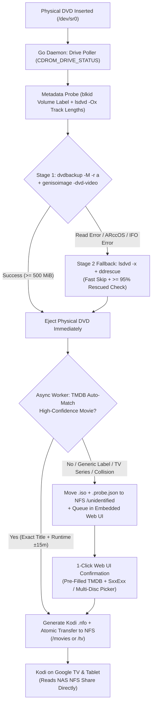

# Home Theatre — Automated DVD ISO Ripper & Kodi NFS Pipeline

A zero-touch, appliance-like DVD backup and library pipeline running in a standalone **DevPod** container (`hometheatre-daemon`) on Linux. Drop a DVD into the physical optical drive and walk away: the daemon automatically decrypts the disc, builds a **1:1 region-free DVD `.iso`** (preserving original DVD menus, bonus features, audio tracks, and subtitles) on local scratch storage, **immediately ejects the physical tray**, matches the title against **TMDB**, generates a **Kodi `.nfo` sidecar**, and transfers the finalized files to your **NAS NFS share** for direct playback on **Google TV** and **Android tablets**.

---

## Quick Start (Linux Host with DevPod)

### 1. Mount Your NAS Media Folder on the Host (`/mnt/nfs`)
Mount your NAS media export at a known host path (default `/mnt/nfs`), which `deploy/devcontainer.json` bind-mounts into the DevPod daemon container at `/mnt/nfs`:

```bash
sudo mkdir -p /mnt/nfs
sudo mount -t nfs \
  -o rw,nfsvers=4,hard,timeo=600,retrans=2,rsize=1048576,wsize=1048576,noatime \
  <NAS_IP>:<NAS_EXPORT_PATH> /mnt/nfs
```

To make the host mount persistent across reboots, add this line to `/etc/fstab` on your host:

```fstab
<NAS_IP>:<NAS_EXPORT_PATH> /mnt/nfs nfs rw,nfsvers=4,hard,timeo=600,retrans=2,rsize=1048576,wsize=1048576,noatime,_netdev 0 0
```

*(Note: If `/mnt/nfs` is not yet mounted when you run `sudo ./install.sh`, `install.sh` will automatically mount it for you during setup and print the exact `/etc/fstab` line for your NAS).*

### 2. Run the Host Installer
Attach a physical DVD drive (`/dev/sr0`) to your Linux host and run:

```bash
sudo ./install.sh
```

To re-prompt for configuration values on an already-configured host:

```bash
sudo ./install.sh --reconfigure
```

### What `install.sh` Does Automatically
1. **Host & DevPod Prerequisites:** Verifies `devpod` (`devpod-cli`) and required host utilities (`nfs-common`, `dnsutils`, `util-linux`, `lsscsi`, `udev`, `curl`).
2. **SCSI Generic (`sg`) Persistence:** Loads `modprobe sg` and persists `/etc/modules-load.d/hometheatre-sg.conf` so `libdvdcss2` can perform hardware CSS key exchange across reboots.
3. **Optical Drive Discovery:** Scans `/sys/class/block/sr*` and `/device/scsi_generic/sg*` to map both block (`/dev/sr0`) and character (`/dev/sg*`) devices plus `CDROM_GID`.
4. **Scratch Disk Gate:** Verifies `SCRATCH_DIR` has at least **`25 GiB`** of free local disk space (`30+ GiB` recommended for back-to-back dual-layer `DVD-9` ripping).
5. **Host NFS Mount & `root_squash` Ownership:** Resolves `NFS_SERVER` to `NFS_SERVER_IP`, verifies (or mounts) `HOST_NFS_DIR` (`/mnt/nfs`), auto-detects share `PUID`/`PGID`, and tests write permissions via `setpriv` to initialize `movies/`, `tv/`, and `unidentified/`.
6. **TMDB API Validation:** Verifies your `TMDB_API_KEY` (supports both v3 32-character hex API keys and v4 `Bearer` Read Access Tokens) against `https://api.themoviedb.org/3/configuration`.
7. **Standalone DevPod Daemon Deployment:** Renders [`deploy/devcontainer.json`](deploy/devcontainer.json) with your host bind mounts (`SCRATCH_DIR` -> `/scratch`, `HOST_NFS_DIR` -> `/mnt/nfs`) and optical device passthrough, then builds and launches the standalone `hometheatre-daemon` DevPod workspace via `devpod up . --id hometheatre-daemon --devcontainer-path deploy/devcontainer.json --ide none --recreate` (completely separate from the `.devcontainer/` development container).

---

## Pipeline Overview



---

## Embedded Web UI & Unidentified Queue

Open `http://<HOST_IP>:8080` (or the `WEB_PORT` configured in `.env`) to access the embedded dashboard:

- **Live Optical Drive & Ripper State:** Real-time drive status (`Empty`, `Tray Open`, `Spinning Up / Reading TOC`, `Disc Ready`) and active pipeline stage (`Stage 1 dvdbackup`, `Stage 1 genisoimage`, `Stage 2 ddrescue`, or `Waiting for Scratch Space`).
- **Background NFS Transfer Queue:** Shows active/queued transfers and provides a **Retry Transfer Now** button if a transient NAS outage placed a transfer into exponential backoff.
- **1-Click Unidentified / TV / Multi-Disc Tagging Queue:**
  - Statelessly backed by `/mnt/nfs/unidentified/*.probe.json` sidecars.
  - Pre-populates TMDB Movie/TV candidates, season hints, and auto-estimated episode ranges (`S01E01E02...`) from `lsdvd` track lengths.
  - Supports multi-disc collision resolution (**Edition / Disc Suffix** such as `Disc 2` or `Bonus Features`, **Replace Existing `.iso`**, or **Delete Unidentified `.iso`**).
  - Performs instant zero-copy server-side `os.Rename` from `/unidentified` into `/movies` or `/tv` alongside the generated Kodi `.nfo` files.
- **Persistent Rip History & Logs:** Displays the last 100 rips stored in `<SCRATCH_DIR>/history.json` and the live daemon log ring buffer.

---

## NAS NFS Directory Layout

```text
<NFS_ROOT>/
├── movies/
│   └── Movie Title (Year)/
│       ├── Movie Title (Year).iso
│       └── Movie Title (Year).nfo
├── tv/
│   └── Show Title (Year)/
│       ├── tvshow.nfo
│       └── Season 01/
│           ├── Show Title - S01E01E02E03E04.iso
│           └── Show Title - S01E01E02E03E04.nfo
└── unidentified/
    ├── <RAW_LABEL>_<TIMESTAMP>.iso
    └── <RAW_LABEL>_<TIMESTAMP>.probe.json
```

---

## Kodi Setup (Google TV & Android Tablet)

See [`KODI.md`](KODI.md) and the [`sources.xml`](sources.xml) template for full step-by-step instructions:

- **Movies Source:** `nfs://<NFS_SERVER><NFS_PATH>/movies/` (Content: **Movies**, Scraper: **Local information only** or **TMDB Movies**, enable **Movies are in separate folders that match the movie title**).
- **TV Shows Source:** `nfs://<NFS_SERVER><NFS_PATH>/tv/` (Content: **TV shows**, Scraper: **Local information only** or **TMDB TV Shows**).
- **NAS `insecure` Export Requirement:** Standalone Kodi apps on Google TV and Android use userspace `libnfs` from unprivileged ports (`> 1024`). Ensure your NAS NFS export for `<NFS_PATH>` enables `insecure` (or *"Allow non-root mount"* on TrueNAS).

---

## Documentation & Specifications

| Document | Description |
| :--- | :--- |
| [`INTENT.md`](INTENT.md) | Overall system architecture, end-to-end data flow, and design decisions |
| [`DRIVE.md`](DRIVE.md) | Linux `/dev/sr0` + `/dev/sg*` DevPod device passthrough, `CDROM_DRIVE_STATUS` ioctl polling, and `sysfs` discovery |
| [`RIPPING.md`](RIPPING.md) | `libdvdcss2` build stage, two-stage ripping (`dvdbackup` + `genisoimage` -> `ddrescue`), scratch space gate, and `job.json` crash recovery |
| [`METADATA.md`](METADATA.md) | `blkid`/`lsdvd -Ox` probing, Movie vs. TV heuristics, TMDB API matching, Kodi `.nfo` schemas, and webhook payloads |
| [`DOCKER.md`](DOCKER.md) | Standalone DevPod daemon (`deploy/devcontainer.json`), host NFS bind mount (`HOST_NFS_DIR`), `Setfsuid`/`Setfsgid` ownership, and atomic `.partial` file transfers |
| [`KODI.md`](KODI.md) | Kodi NFS onboarding guide for Google TV and Android tablets, scraper settings, and DVD menu playback |
| [`deploy/devcontainer.json`](deploy/devcontainer.json) | Dedicated DevPod daemon configuration (separate from `.devcontainer/` development container) |
| [`.env.example`](.env.example) | Documented template for all host and container environment variables |
| [`sources.xml`](sources.xml) | Ready-to-customize Kodi `userdata/sources.xml` template for ADB push |
