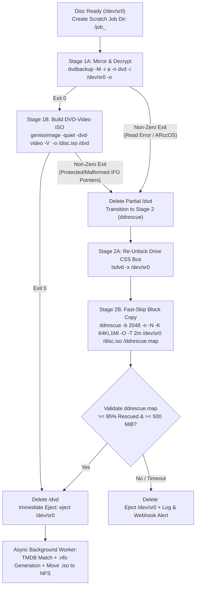

# Two-Stage DVD ISO Ripping Pipeline & `libdvdcss2` Container Setup (`RIPPING.md`)

This document specifies the container build configuration for `libdvdcss2` and the exact CLI invocations, flags, error transitions, and validation rules for the two-stage DVD `.iso` ripping pipeline (resolving [Issue #3](https://github.com/brotherlogic/hometheatre/issues/3)).

---

## 1. Multi-Stage `Dockerfile` & Deterministic `libdvdcss2` Installation

### 1.1 Why Build `libdvdcss2` in an Intermediate Stage
- Debian and Ubuntu do not ship pre-compiled `libdvdcss2` binaries in their main repositories for legal/distribution reasons; instead, Debian `contrib` (and Ubuntu `multiverse`) provides `libdvd-pkg`, which downloads the upstream VideoLAN source tarball (verified against built-in SHA-256 checksums) and compiles `libdvdcss2_*.deb` via `dpkg-reconfigure`.
- Running `libdvd-pkg` directly in the final runtime image pulls in `build-essential`, `gcc`, `make`, `debhelper`, and `dh-autoreconf` (~150+ MB of compiler bloat).
- Conversely, adding third-party `download.videolan.org` apt repositories introduces external GPG key and distro codename fragility.

By compiling `libdvdcss2_*.deb` via `libdvd-pkg` in a dedicated intermediate build stage (`dvdcss-builder`) and copying only the resulting `.deb` package into the final `debian:bookworm-slim` runtime stage, the build remains 100% self-contained, non-interactive, and keeps the runtime image minimal.

### 1.2 Multi-Stage `Dockerfile` Specification

```dockerfile
# ==============================================================================
# Stage 1: Build Go Daemon & Embedded Web UI
# ==============================================================================
FROM golang:1.22-bookworm AS go-builder
WORKDIR /src
COPY go.mod go.sum ./
RUN go mod download
COPY . .
RUN CGO_ENABLED=0 GOOS=linux go build -trimpath -ldflags="-s -w" -o /out/hometheatre ./cmd/hometheatre

# ==============================================================================
# Stage 2: Build libdvdcss2 .deb Non-Interactively via Debian contrib libdvd-pkg
# ==============================================================================
FROM debian:bookworm-slim AS dvdcss-builder
ENV DEBIAN_FRONTEND=noninteractive
RUN sed -i 's/Components: main/Components: main contrib/g' /etc/apt/sources.list.d/debian.sources && \
    apt-get update && \
    apt-get install -y --no-install-recommends \
        ca-certificates \
        libdvd-pkg && \
    dpkg-reconfigure -f noninteractive libdvd-pkg && \
    for deb in /usr/src/libdvd-pkg/libdvdcss2_*.deb; do \
        dpkg-deb -R "$deb" /tmp/libdvdcss2-repack && \
        sed -i -E 's/(^Depends:.*)libdvd-pkg, */\1/; s/(^Depends:.*), *libdvd-pkg/\1/; s/^Depends: *libdvd-pkg$/Depends:/' /tmp/libdvdcss2-repack/DEBIAN/control && \
        dpkg-deb -b /tmp/libdvdcss2-repack "$deb" && \
        rm -rf /tmp/libdvdcss2-repack && \
        ! dpkg-deb -f "$deb" Depends | grep -q libdvd-pkg; \
    done && \
    ls -la /usr/src/libdvd-pkg/libdvdcss2_*.deb

# ==============================================================================
# Stage 3: Minimal Runtime Image
# ==============================================================================
FROM debian:bookworm-slim
ENV DEBIAN_FRONTEND=noninteractive

# Install runtime CLI dependencies
RUN apt-get update && \
    apt-get install -y --no-install-recommends \
        ca-certificates \
        dvdbackup \
        eject \
        gddrescue \
        genisoimage \
        libdvdread8 \
        lsdvd \
        procps \
        util-linux && \
    rm -rf /var/lib/apt/lists/*

# Install pre-built libdvdcss2 package from Stage 2
COPY --from=dvdcss-builder /usr/src/libdvd-pkg/libdvdcss2_*.deb /tmp/
RUN dpkg -i /tmp/libdvdcss2_*.deb && rm -f /tmp/libdvdcss2_*.deb

# Copy static Go binary from Stage 1
COPY --from=go-builder /out/hometheatre /usr/local/bin/hometheatre

# Create idempotent DevPod background daemon launcher with auto-restart loop
RUN cat <<'EOF' > /usr/local/bin/start-daemon.sh && chmod 0755 /usr/local/bin/start-daemon.sh
#!/usr/bin/env bash
set -euo pipefail

if pgrep -x hometheatre >/dev/null 2>&1; then
    exit 0
fi

export OPTICAL_DEVICE="${CONTAINER_OPTICAL_DEVICE:-/dev/sr0}"
export SCRATCH_DIR="${CONTAINER_SCRATCH_DIR:-/scratch}"
export NFS_ROOT="${CONTAINER_NFS_ROOT:-/mnt/nfs}"
export DVDCSS_METHOD="${DVDCSS_METHOD:-key}"
export DVDCSS_CACHE="${DVDCSS_CACHE:-/scratch/.dvdcss}"
export DVDCSS_VERBOSE="${DVDCSS_VERBOSE:-1}"

nohup bash -c '
    while true; do
        /usr/local/bin/hometheatre >> /var/log/hometheatre.log 2>&1 || true
        sleep 2
    done
' >/dev/null 2>&1 &
EOF

EXPOSE 8080

ENTRYPOINT ["/usr/local/bin/hometheatre"]
```

### 1.3 `libdvdcss2` Runtime Environment Variables
The Go daemon sets the following environment variables for all child processes (`lsdvd`, `dvdbackup`):
- `DVDCSS_METHOD=key`: Attempts normal CSS bus-key/title-key exchange first, and automatically falls back inside `libdvdcss2` to `disc` and `title` cipher-stream cracking if the optical drive has a mismatched RPC-2 region code.
- `DVDCSS_CACHE=${SCRATCH_DIR}/.dvdcss`: Caches cracked title keys on the local scratch volume by disc ID so keys unlocked during the initial `lsdvd` probe are reused immediately by `dvdbackup` and Stage 2 re-authentication without re-cracking.
- `DVDCSS_VERBOSE=1`: Logs CSS key exchange diagnostic messages to stderr for troubleshooting encrypted discs.

---

## 2. Two-Stage Ripping Pipeline Overview

To guarantee that the physical disc is still available in the drive if `genisoimage -dvd-video` encounters corrupted/protected `.IFO` tables, **`genisoimage -dvd-video` runs on the local scratch disk prior to ejecting the disc** (adding ~20–45 seconds on local SSD/HDD). Once a valid `.iso` is finalized in local scratch (either via Stage 1 or Stage 2 fallback), the drive immediately ejects the physical DVD while TMDB lookup, `.nfo` generation, and the multi-gigabyte NFS transfer proceed asynchronously in the background.



---

## 3. Stage 1: `dvdbackup` + `genisoimage` Specification

### 3.1 Step 1A — Decrypt and Mirror `VIDEO_TS` (`dvdbackup`)
```bash
dvdbackup -M -r a -n dvd -i /dev/sr0 -o "<job_dir>"
```
- **`-M` (`--mirror`):** Mirrors the complete decrypted `VIDEO_TS` structure (menus, main feature, extras, all audio streams, and subpictures).
- **`-n dvd` (`--name=dvd`):** Forces a deterministic output directory `<job_dir>/dvd/VIDEO_TS`.
  - Without `-n`, `dvdbackup` attempts to derive the folder name from the DVD title and **exits with return code `2`** if the disc has a generic (`DVD_VIDEO`), blank, or spaces-only volume title.
- **`-r a` (`--error=a`):** Aborts immediately on the first unrecoverable sector read error (overriding `dvdbackup`'s default `-r m` skip-multiple-blocks mode).
  - Failing fast on the first unreadable/ARccOS dummy sector avoids spending 20+ minutes grinding on structural protection sectors in Stage 1 and immediately hands off to Stage 2 (`ddrescue`).

### 3.2 Step 1B — Build Compliant DVD-Video `.iso` (`genisoimage`)
```bash
genisoimage -quiet -dvd-video -V "<SAFE_LABEL_32>" -o "<job_dir>/disc.iso" "<job_dir>/dvd"
```
- **`-dvd-video`:** Generates a DVD-Video compliant UDF 1.02 + ISO9660 bridge filesystem, enforces strict physical sector ordering (`VIDEO_TS.IFO`, `VIDEO_TS.VOB`, `VIDEO_TS.BUP`, followed by `VTS_XX_0.IFO`, `VTS_XX_0.VOB`, `VTS_XX_1..9.VOB`, `VTS_XX_0.BUP`), and supports both single-layer (`DVD-5`, 4.7 GB) and dual-layer (`DVD-9`, 8.5 GB) discs because individual `.VOB` extents are split at `< 1 GiB`.
- **`-V "<SAFE_LABEL_32>"`:** Preserves the sanitized DVD volume label inside the `.iso` header.
  - Because `genisoimage` enforces a maximum 32-character volume ID (`-V`), the Go daemon sanitizes the raw `blkid` label to `[A-Z0-9_]` and truncates it to at most 32 characters (falling back to `DVD_VIDEO` if empty).
- **`-quiet`:** Suppresses per-percent progress spam on `stderr` while keeping fatal error messages intact.
- **Cleanup & Fallback:**
  - If `genisoimage` exits `0` (and `<job_dir>/disc.iso` is `>= 500 MiB`), the daemon removes `<job_dir>/dvd` and immediately runs `eject /dev/sr0`.
  - If `dvdbackup` or `genisoimage` exits non-zero (for example, `genisoimage` rejecting intentionally overlapping/corrupted ARccOS `IFO` padding tables), the daemon deletes `<job_dir>/dvd` and transitions immediately to Stage 2 while the disc is still in `/dev/sr0`.

---

## 4. Stage 2 Fallback: CSS Re-Authentication & `ddrescue` Specification

### 4.1 Why Stage 2 is Needed
Commercial DVDs protected with **Sony ARccOS**, **Disney X-Protect (99-title)**, or **Lionsgate RipGuard**—as well as older discs with minor surface scratches—contain intentionally corrupted radial bad-sector rings in unreferenced gap cells or deliberate `IFO` table anomalies.
- A direct 1:1 sector image via `ddrescue` preserves the exact physical sector offsets that structural protection checks expect while replacing unreadable dummy sectors with zero-filled blocks.
- Kodi's built-in `VideoPlayer` (`libdvdnav` + `libdvdread` + `libdvdcss`) plays these 1:1 `.iso` images directly over NFS, using `VIDEO_TS.IFO` cell navigation to jump cleanly over the zero-filled dummy sectors and decrypting any CSS-scrambled `.VOB` sectors on the fly.

### 4.2 Step 2A — Re-Unlocking the Optical Drive CSS Bus
When an optical drive encounters a hard SCSI read error during Stage 1 (`dvdbackup -r a`), many drive firmwares reset their MMC bus state and revoke the active CSS bus authentication session. Reading encrypted `.VOB` sectors via `/dev/sr0` without an active CSS bus session causes the drive to reject every encrypted sector with SCSI Sense `05/6F/03` (`READ OF SCRAMBLED SECTOR WITHOUT AUTHENTICATION`).

Before starting `ddrescue`, the daemon runs:
```bash
lsdvd -x /dev/sr0 >/dev/null 2>&1 || dvdbackup -I -i /dev/sr0 >/dev/null 2>&1
```
With `DVDCSS_CACHE=${SCRATCH_DIR}/.dvdcss` populated, `libdvdread`/`libdvdcss2` iterates across the disc's title sets and re-authenticates the drive bus in 1–2 seconds so `/dev/sr0` permits raw sector reads across the entire disc.

### 4.3 Step 2B — Fast-Skip `ddrescue` Invocation
```bash
ddrescue \
  -b 2048 \
  -n \
  -N \
  -K 64Ki,1Mi \
  -O \
  -T 2m \
  /dev/sr0 \
  "<job_dir>/disc.iso" \
  "<job_dir>/ddrescue.map"
```

| Flag | Long Option | Rationale |
| :--- | :--- | :--- |
| `-b 2048` | `--sector-size=2048` | Matches the native 2,048-byte (`2 KiB`) hardware sector size of DVD media. |
| `-n` | `--no-scrape` | Skips the scraping phase so `ddrescue` does not spend hours retrying unreadable ARccOS dummy sectors one by one. |
| `-N` | `--no-trim` | Skips the trimming phase so `ddrescue` does not stall walking inward toward the edges of bad-sector clusters. |
| `-K 64Ki,1Mi` | `--skip-size=64Ki,1Mi` | Sets initial skip on read error to `64 KiB` (32 sectors) and caps maximum skip size at `1 MiB` (512 sectors). Capping the maximum skip at `1 MiB` (instead of `ddrescue`'s default 1% of disc size, ~80 MiB) ensures ARccOS bad rings are bypassed in seconds without leaping past valid video cells immediately following the ring. |
| `-O` | `--reopen-on-error` | Reopens `/dev/sr0` after each read error to clear sticky kernel/SCSI block error flags. |
| `-T 2m` | `--timeout=2m` | Aborts if more than 2 minutes elapse without any successful sector read (prevents infinite hangs if a drive wedges). |

### 4.4 Step 2C — Mapfile & Output Validation (`>= 95%` Rescued)
Because `ddrescue` exits with status `0` after completing its copying pass even when bad sectors were skipped, the Go daemon parses `<job_dir>/ddrescue.map` before accepting `<job_dir>/disc.iso`:

1. **Mapfile Format & Parsing:**
   - Every non-comment block line after the status line in `ddrescue.map` has the format:
     ```text
     <pos_hex>  <size_hex>  <status_char>
     ```
     where `<status_char>` is `+` for successfully rescued blocks and `?`, `*`, `/`, or `-` for non-tried/non-trimmed/non-scraped/bad-sector blocks.
   - The daemon sums `rescued_bytes` (`status == '+'`) and `total_bytes` (sum of all block sizes):
     ```go
     rescuedRatio := float64(rescuedBytes) / float64(totalBytes)
     ```
2. **Acceptance Criteria:**
   - `ddrescue` exited with status `0`,
   - `<job_dir>/disc.iso` size is `>= 500 MiB` (`524,288,000` bytes), **and**
   - `rescuedRatio >= 0.95` (at least **95.0%** of the disc's sectors were cleanly read; typical ARccOS/RipGuard dummy rings occupy only 10–150 MB, or `0.2%–3.0%` of the disc).
3. **Failure Handling:**
   - If `ddrescue` exits non-zero, times out (`-T 2m`), or `rescuedRatio < 0.95`:
     - The daemon deletes `<job_dir>/disc.iso` and `<job_dir>/ddrescue.map` from local scratch so broken partial images never pollute the NAS NFS share.
     - Runs `eject /dev/sr0`.
     - Records the failed rip in the Web UI history (including stage, `rescuedRatio`, and stderr tail) and sends a failure notification to `WEBHOOK_URL` if configured.

---

## 5. Scratch Disk Capacity Gate & Crash Recovery (`/scratch/job_<id>`)

### 5.1 Peak Scratch Usage & Pre-Rip Free Space Gate (`>= 18 GiB`)
- During Stage 1B (`genisoimage`), both the mirrored `VIDEO_TS` directory (`<job_dir>/dvd`, up to `8.5 GB` for a dual-layer `DVD-9`) and the output `<job_dir>/disc.iso` (up to `8.5 GB`) coexist briefly on `<SCRATCH_DIR>` for ~20–45 seconds, requiring up to **~17 GB** of peak local disk space for a single disc.
- If a user inserts a new DVD while a previous `8.5 GB` `.iso` is still transferring over the network to the NAS (or waiting in NFS retry backoff), peak scratch usage reaches **~25.5 GB**.
- To prevent mid-rip `ENOSPC` failures:
  1. **Host Pre-Flight (`install.sh`):** Verifies that `SCRATCH_DIR` has at least **`25 GiB`** (`26,843,545,600` bytes) of free space (recommending `30+ GiB` for back-to-back dual-layer ripping).
  2. **Runtime Space Gate (`unix.Statfs`):** Before starting Stage 1 (`dvdbackup`) on a newly inserted disc, the Go daemon checks `Bavail * Bsize` on `/scratch`.
     - If available space is **`< 18 GiB`** and an in-flight or queued NFS transfer is currently holding a finalized `.iso` in `/scratch`, the rip worker pauses in `Waiting for Scratch Space` state until the NFS transfer completes and deletes the previous scratch `.iso`.
     - If available space remains `< 18 GiB` with no pending transfers that can free space, the daemon aborts before ripping, logs an `insufficient_scratch_space` error, sends a webhook alert, and ejects the disc.

### 5.2 Container Restart & Crash Recovery (`job.json`)
To ensure orphaned files never accumulate on `/scratch` and finalized local `.iso` rips are never lost if the container restarts before the NAS transfer completes:
1. **Job State File (`<job_dir>/job.json`):**
   - When a rip begins in `/scratch/job_<id>`, the daemon writes `/scratch/job_<id>/job.json`:
     ```json
     {
       "job_id": "job_20261018T153000Z",
       "started_at": "2026-10-18T15:30:00Z",
       "state": "ripping",
       "stage": "stage1_dvdbackup",
       "raw_label": "THE_MATRIX_16X9",
       "tracks_seconds": [8160.2]
     }
     ```
   - Immediately after `<job_dir>/disc.iso` passes validation (and before `eject /dev/sr0`), the daemon updates `job.json` to `"state": "iso_finalized"` and `fsync`s it.
2. **Startup Reconciliation:**
   - When the Go daemon starts up, it scans `/scratch/job_*`:
     - **Interrupted Rip (`state != "iso_finalized"` or missing/invalid `disc.iso`):** Immediately deletes `/scratch/job_<id>` to reclaim gigabytes from interrupted `dvdbackup` or `ddrescue` runs.
     - **Finalized Rip Pending Transfer (`state == "iso_finalized"` with valid `disc.iso`):** Automatically re-enqueues the job into the background TMDB + NFS transfer worker.

